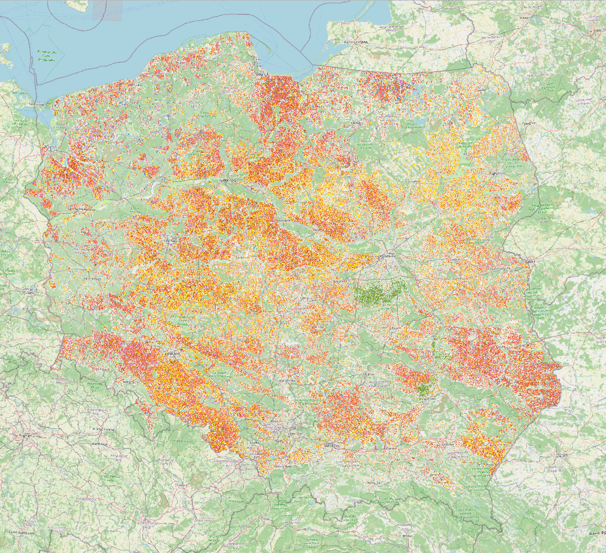
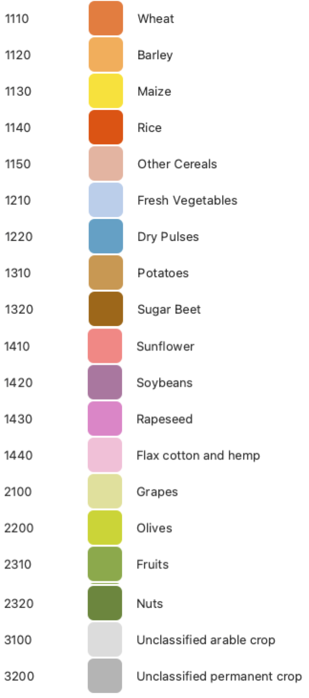

### Cropland

**Source:**

[Copernicus Land Monitoring Service (CLMS)](https://land.copernicus.eu/en/products/high-resolution-layer-croplands) — **High Resolution Layer Crop Types (CTY)**  
*Crop Types 2017 – Present (raster 10 m), Europe, yearly* (Nov. 2024 release).

Product: [Crop Types](https://land.copernicus.eu/en/products/high-resolution-layer-croplands?tab=crop_types) · Cite CLMS / EEA when using the data.

**Description:**

Yearly **10 m** crop-type classification for arable and permanent crops (17 named crop classes + unclassified arable/permanent). Built from **Sentinel-1** and **Sentinel-2** time series (field boundaries, then main crop per field). Part of CLMS High Resolution Layer Croplands.

Hackathon packages are **Poland-only**, reprojected to **EPSG:4326**, one ZIP per year. Download links will be published on Friday morning (20 Nov 2026) in the Discord channel.

**Related CLMS layers (optional)**

The shared packages are the main **crop type** map. For your prototype you may also pull other HRL Croplands layers yourselves if they fit the track — **[cropping patterns](https://land.copernicus.eu/en/products/high-resolution-layer-croplands?tab=cropping_patterns)**. Document source, year, and AOI in your team README.

**Spatial extent**

Poland — tiled GeoTIFFs covering the country (`CLMS_HRLVLCC_CTY_PL_*.tif`). Example overview:

<div align="center">
  
</div>

**Temporal coverage**

Hackathon packages: **2020, 2021, 2022, 2023, 2024** (one ZIP per year; folder stamped `YYYY0101`).  
Full CLMS product: annually from **2017** onward (Europe / EEA38).

**Resolution / CRS**

- Native CLMS product: **10 m**, EEA reference grid (**EPSG:3035** typical)
- Hackathon delivery: GeoTIFF tiles in **EPSG:4326** (WGS84) — see filenames `cropland_pl_4326_YYYY.zip`
- Pixel type: **UInt16** class codes (single band)

**File format**

GeoTIFF (`.tif`), packaged as ZIP per year. Legend / symbology files (`.clr`, `.qml`, `.sld`, `.lyr`) are included under `legend/`.

**Directory layout**

```text
cropland_data/
├── cropland_pl_4326_2020.zip
├── cropland_pl_4326_2021.zip
├── cropland_pl_4326_2022.zip
├── cropland_pl_4326_2023.zip
└── cropland_pl_4326_2024.zip
```

After unpack (example for 2024):

```text
Results/Crop Types 2017-present (raster 10 m), Europe, yearly/
├── legend/
│   ├── clms_vlcc_crop-types_europe_10m_yearly_v1.clr
│   ├── clms_vlcc_crop-types_europe_10m_yearly_v1.qml
│   ├── clms_vlcc_crop-types_europe_10m_yearly_v1.sld
│   └── clms_vlcc_crop-types_europe_10m_yearly_v1.lyr
└── 20240101/
    ├── CLMS_HRLVLCC_CTY_PL_0.tif
    ├── CLMS_HRLVLCC_CTY_PL_1.tif
    ├── …
    └── CLMS_HRLVLCC_CTY_PL_47.tif   # 48 tiles (0–47) per year package
```

**Schema / attributes (class codes)**

Single-band raster — pixel value = crop class. Legend:

<div align="center">
  
</div>

| Code | Class |
|------|--------|
| 0 | No cropland |
| 1110 | Wheat |
| 1120 | Barley |
| 1130 | Maize |
| 1140 | Rice |
| 1150 | Other cereals |
| 1210 | Fresh vegetables |
| 1220 | Dry pulses |
| 1310 | Potatoes |
| 1320 | Sugar beet |
| 1410 | Sunflower |
| 1420 | Soybeans |
| 1430 | Rapeseed |
| 1440 | Flax, cotton and hemp |
| 2100 | Grapes |
| 2200 | Olives |
| 2310 | Fruits |
| 2320 | Nuts |
| 3100 | Unclassified arable crop |
| 3200 | Unclassified permanent crop |
| 65535 | Outside area |

**How to use (quick)**

1. Download only the year ZIP(s) you need first. Download links will be published on Friday morning (20 Nov 2026) in Discord channel.
2. Unzip and open the tile(s) covering your AOI (do not load all 48 at once unless needed).
3. Map pixel values with the table / legend above (or load the included `.qml` / `.clr` in QGIS).
4. Download the other years' data if needed and load only for the chosen AOI / tile(s).

```python
# pip install rasterio numpy
import numpy as np
import rasterio

with rasterio.open("CLMS_HRLVLCC_CTY_PL_0.tif") as src:
    print(src.crs, src.res, src.dtypes)
    arr = src.read(1)
    vals, counts = np.unique(arr, return_counts=True)
    print(list(zip(vals[:10], counts[:10])))
```

**Tips**

- Prefer windowed reads / VRT mosaics over opening every tile into memory.
- Do **not** commit GeoTIFF ZIPs — keep them local (see root `.gitignore`).
