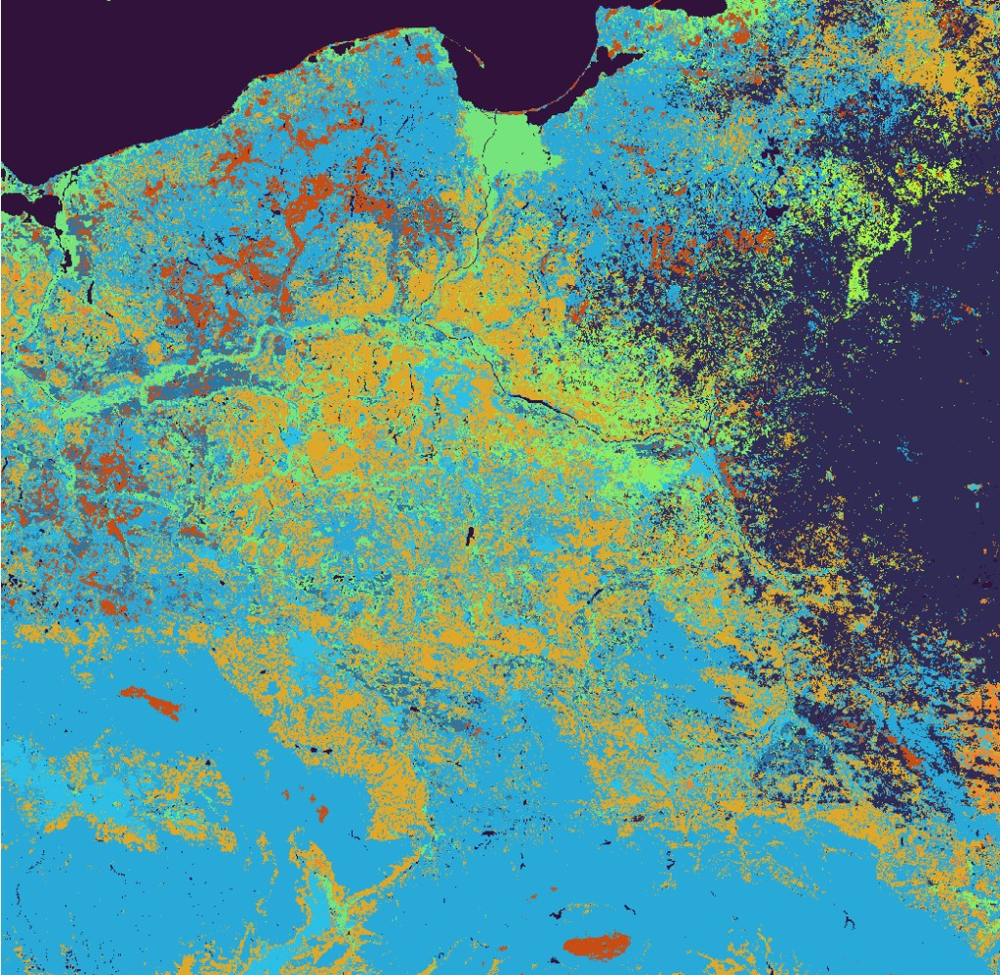

### Soil

**Source:**

[ISRIC SoilGrids](https://www.isric.org/explore/soilgrids) - **Soil 250 v2** (2022). Global digital soil mapping from soil profiles and environmental covariates. Public data under [CC-BY 4.0](https://creativecommons.org/licenses/by/4.0/).

**Description:**

Predicted soil properties on a 250 m grid, indexed with **H3 level 10** for spatial join. Includes bulk density, texture (sand / silt / clay), coarse fragments, CEC, pH, nitrogen, organic carbon (content, density, stocks), plus root-zone aggregates and USDA texture class.

Hackathon packages are split by **voivodeship**. Download links will be published on Friday morning (20 Nov 2026) in Discord channel.

**Spatial extent**

Poland - packages per voivodeship (same regional split as other hackathon datasets). Example soil texture / class map (excerpt):

<div align="center">
  
</div>

**Temporal coverage**

Static map product (**SoilGrids 2022 / Soil 250 v2**). Not a time series - one soil attribute set per H3 cell.

**Resolution / CRS**

- Native mapping resolution: **250 m**
- Spatial index: **H3 level 10** (`h3_index_10`)
- Join key for AOIs / fields: compute H3 L10 from lat/lon (or polygon polyfill), then join on `h3_index_10`

**File format**

Parquet (`.parquet`), packaged as ZIP per voivodeship.

**Directory layout**

```text
soil_data/
├── soil_Dolnoslaskie_isric_250_v2.zip
├── soil_Kujawsko_Pomorskie_isric_250_v2.zip
├── soil_Lubelskie_isric_250_v2.zip
├── soil_Lubuskie_isric_250_v2.zip
├── soil_Mazowieckie_isric_250_v2.zip
├── soil_Opolskie_isric_250_v2.zip
├── soil_Podkarpackie_isric_250_v2.zip
├── soil_Podlaskie_isric_250_v2.zip
├── soil_Pomorskie_isric_250_v2.zip
├── soil_Slaskie_isric_250_v2.zip
├── soil_Swietokrzyskie_isric_250_v2.zip
├── soil_Warminsko_Mazurskie_isric_250_v2.zip
├── soil_Wielkopolskie_isric_250_v2.zip
├── soil_Zachodniopomorskie_isric_250_v2.zip
└── soil_Łódzkie_isric_250_v2.zip
```

**Schema / attributes**

Depth intervals for layered properties: **0–5 · 5–15 · 15–30 · 30–60 · 60–100 · 100–200 cm** (unless noted).

| Column Name | Data Type | Description | UoM |
|-------------|-----------|-------------|-----|
| h3_index_10 | STRING | H3 index at level 10 | - |
| hid | INTEGER | Partition key (derived from H3) | - |
| bdod_*_mean | FLOAT | Mean bulk density of the fine earth fraction (depths as above; see note¹) | kg/dm³ |
| cec_*_mean | FLOAT | Mean cation exchange capacity | cmol(c)/kg |
| cfvo_*_mean | FLOAT | Mean volumetric fraction of coarse fragments (> 2 mm) | cm³/100cm³ (vol%) |
| clay_*_mean | FLOAT | Mean clay fraction (< 0.002 mm) in fine earth | g/100g (%) |
| nitrogen_*_mean | FLOAT | Mean total nitrogen (N) | g/kg |
| phh2o_*_mean | FLOAT | Mean soil pH (H₂O) | pH |
| ocd_*_mean | FLOAT | Mean organic carbon density | kg/m³ |
| ocs_0_30cm_mean | INTEGER | Organic carbon stocks (0–30 cm) | t/ha |
| sand_*_mean | FLOAT | Mean sand fraction (> 0.05 mm) in fine earth | g/100g (%) |
| silt_*_mean | FLOAT | Mean silt fraction (0.002–0.05 mm) in fine earth | g/100g (%) |
| soc_*_mean | FLOAT | Mean soil organic carbon in fine earth | g/kg |
| om | FLOAT | Organic matter - weighted average root zone SOC to 30 cm | g/kg |
| cec | FLOAT | CEC - weighted average root zone to 30 cm | cmol(c)/kg |
| pH | FLOAT | pH - weighted average root zone to 15 cm | pH |
| sand | FLOAT | Sand % - weighted average root zone to 30 cm | % |
| silt | FLOAT | Silt % - weighted average root zone to 30 cm | % |
| clay | FLOAT | Clay % - weighted average root zone to 30 cm | % |
| bulk_density | FLOAT | Bulk density - weighted average root zone to 30 cm | kg/dm³ |
| band_om | FLOAT | Categorical OM: low (< 2), moderate, high (> 3.5) | - |
| band_cec | FLOAT | Categorical CEC: low (< 10), moderate, high (> 20) | - |
| band_pH | FLOAT | Categorical pH: low (< 5.8), moderate, high (> 7.5) | - |
| soil_texture | STRING | USDA soil texture class from root-zone sand/silt/clay (to 30 cm) | - |

**Layered column names** (replace `*` with depth):  
`0_5cm` · `5_15cm` · `15_30cm` · `30_60cm` · `60_100cm` · `100_200cm`  
Examples: `clay_0_5cm_mean`, `phh2o_15_30cm_mean`, `soc_60_100cm_mean`.

¹ `bdod` in the v2 schema lists `0_5`, `5_15`, `30_60`, `60_100`, `100_200` (no `15_30` column in the published schema).

Reference naming: [ISRIC SoilGrids FAQ](https://www.isric.org/explore/soilgrids/faq-soilgrids).

**How to use (quick)**

1. Download the voivodeship ZIP(s) you need ([links](README.md)).
2. Convert your AOI / field lat/lon to **H3 level 10**.
3. Join soil Parquet on `h3_index_10`. Prefer **DuckDB** for large files.

```python
# pip install duckdb h3
import duckdb
import h3

lat, lon = 52.23, 21.01
h3_cell = h3.latlng_to_cell(lat, lon, 10)

con = duckdb.connect()
df = con.sql(f"""
    SELECT
        h3_index_10,
        clay_0_5cm_mean,
        sand_0_5cm_mean,
        silt_0_5cm_mean,
        phh2o_0_5cm_mean,
        soc_0_5cm_mean,
        soil_texture
    FROM read_parquet('soil_Mazowieckie_isric_250_v2.parquet')
    WHERE h3_index_10 = '{h3_cell}'
""").df()
```

For polygons, polyfill the geometry at H3 level 10 and filter with `h3_index_10 IN (...)`.
