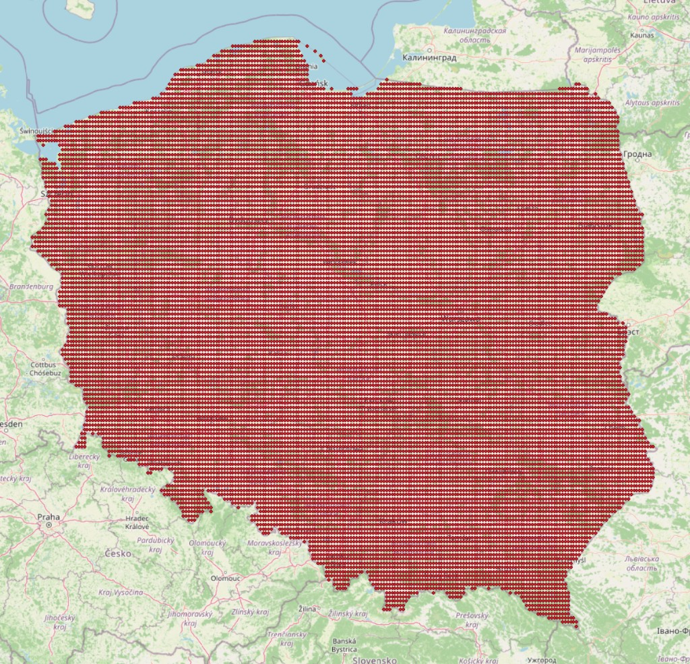

### Weather

**Source:**

AI-powered historical weather dataset (metric units). Combines downscaled / ML-enhanced gridded weather with topographic and land-cover context; other variables draw on reanalysis / NWP inputs (e.g. ECMWF) and station-trained models.

**Precipitation (separate product):** NASA [IMERG](https://gpm.nasa.gov/data/imerg) (Integrated Multi-satellite Retrievals for GPM), provided as its own daily and hourly tables/packages - not mixed into the main weather tables.

**Description:**

Gridded historical weather for Poland: temperature, humidity, wind, precipitation, solar radiation, pressure, cloud cover, snow, soil temperature/moisture, and reference evapotranspiration (ETo / ETr). Join observations to locations via `grid_id` from the grid table.

IMERG precipitation is a **separate table** (`imerg_precipitation_daily` / `imerg_precipitation_hourly`); join it to weather or grids on `grid_id` (+ `date` / time) when you need satellite precipitation.

Hackathon packages are split by **voivodeship** and **year** (daily and hourly). Grid geometry and IMERG packages are separate. Download links will be published on Friday morning (20 Nov 2026) in Discord channel.

**Spatial extent**

Poland - 4 km land grids clipped to national borders (Baltic coast through southern mountains; west/east borders followed closely).

<div align="center">
  
</div>

**Temporal coverage**

| Product | Years in hackathon packages |
|---------|-----------------------------|
| Daily   | 2020 – 2025                 |
| Hourly  | 2020 - 2025                 |

Daily aggregations use **local time**. Only the years above are provided for the hackathon.

**Resolution / CRS**

- Spatial resolution: **4 km** regular grid
- Coordinates: WGS84 (`lat` / `lon`, EPSG:4326)
- Geometry: point / geography per grid cell (`geom` in the grid table)

**File format**

Parquet (`.parquet`), packaged as ZIP per voivodeship / year. Example filename pattern after unpack: `Dolnośląskie_daily_2020.parquet`.

**Directory layout**

```text
weather_data/
├── daily/
│   ├── 2020/
│   │   ├── weather_daily_2020_Dolnoslaskie.zip
│   │   ├── weather_daily_2020_Kujawsko-Pomorskie.zip
│   │   └── …   # one ZIP per voivodeship
│   ├── 2021/
│   │   └── …
│   ├── 2022/
│   │   └── …
│   ├── 2023/
│   │   └── …
│   ├── 2024/
│   │   └── …
│   └── 2025/
│       └── …
├── hourly/
│   ├── 2020/
│   │   ├── weather_hourly_2020_Dolnoslaskie.zip
│   │   ├── weather_hourly_2020_Kujawsko-Pomorskie.zip
│   │   └── …   # one ZIP per voivodeship
│   ├── 2022/
│   │   └── …
│   ├── 2023/
│   │   └── …
│   ├── 2024/
│   │   └── …
│   └── 2025/
│       └── …
├── imerg_precipitation_daily.zip
├── imerg_precipitation_hourly.zip
└── weather_grids.zip
```

Download links for each package: [`README.md`](README.md).

**Schema / attributes**

#### `grid_table`

Spatial lookup for weather cells. Join to daily/hourly on `grid_id`.

| Column Name | Data Type | Description |
|-------------|-----------|-------------|
| grid_id | STRING | Unique 4 km grid identifier |
| lat | FLOAT | Grid latitude (WGS84) |
| lon | FLOAT | Grid longitude (WGS84) |
| geom | GEOGRAPHY / WKT | Grid point geometry |
| geohash4 | STRING | Geohash precision 4 (spatial filter helper) |
| time_zone | STRING / FLOAT | Local timezone of the grid |

#### `daily_table`

One row per `grid_id` × local calendar `date`. Units are metric.

| Column Name | Data Type | Unit | Description |
|-------------|-----------|------|-------------|
| grid_id | STRING | - | Weather grid id |
| date | DATE | - | Local calendar date |
| max_temperature | FLOAT | °C | Max of 24 hourly values (00:00–23:00) |
| min_temperature | FLOAT | °C | Min of 24 hourly values |
| midpoint_temperature | FLOAT | °C | (min + max) / 2 |
| avg_temperature | FLOAT | °C | Mean of 24 hourly values |
| max_dew_point_temperature | FLOAT | °C | Max dew point |
| min_dew_point_temperature | FLOAT | °C | Min dew point |
| avg_dew_point_temperature | FLOAT | °C | Average dew point |
| total_precipitation | FLOAT | mm | Daily total precipitation; sum of 24 hourly values |
| max_wind_speed | FLOAT | km h⁻¹ | Max wind speed at 10 m |
| min_wind_speed | FLOAT | km h⁻¹ | Min wind speed at 10 m |
| avg_wind_speed | FLOAT | km h⁻¹ | Average wind speed at 10 m |
| avg_wind_direction | FLOAT | ° (azimuth) | Vector-average wind direction at 10 m |
| max_wind_gust | FLOAT | km h⁻¹ | Max wind gust at 10 m¹ |
| max_wind_speed_2m | FLOAT | km h⁻¹ | Max wind speed at 2 m |
| min_wind_speed_2m | FLOAT | km h⁻¹ | Min wind speed at 2 m |
| avg_wind_speed_2m | FLOAT | km h⁻¹ | Average wind speed at 2 m |
| max_relative_humidity | FLOAT | % | Max relative humidity |
| min_relative_humidity | FLOAT | % | Min relative humidity |
| avg_relative_humidity | FLOAT | % | Average relative humidity |
| total_downward_solar_radiation | FLOAT | MJ m⁻² day⁻¹ | Daily total downward solar radiation |
| max_downward_solar_radiation | FLOAT | MJ m⁻² hour⁻¹ | Max hourly downward solar radiation |
| total_net_solar_radiation | FLOAT | MJ m⁻² day⁻¹ | Daily total net solar radiation |
| max_net_solar_radiation | FLOAT | MJ m⁻² hour⁻¹ | Max hourly net solar radiation |
| min_atmospheric_pressure | FLOAT | mbar | Min surface pressure |
| max_atmospheric_pressure | FLOAT | mbar | Max surface pressure |
| avg_atmospheric_pressure | FLOAT | mbar | Average surface pressure |
| avg_total_cloud_cover | FLOAT | fraction 0–1 | Average total cloud cover¹ |
| avg_snow_depth | FLOAT | mm water eq. | Average snow depth² |
| avg_snow_density | FLOAT | kg m⁻³ | Average snow density |
| max_soil_temperature_level_1 … _4 | FLOAT | °C | Max soil temperature by layer³ |
| min_soil_temperature_level_1 … _4 | FLOAT | °C | Min soil temperature by layer³ |
| avg_soil_temperature_level_1 … _4 | FLOAT | °C | Average soil temperature by layer³ |
| avg_soil_moisture_level_1 … _4 | FLOAT | m³ m⁻³ | Average volumetric soil water by layer³ |
| eto | FLOAT | mm day⁻¹ | Short (grass) reference evapotranspiration |
| etr | FLOAT | mm day⁻¹ | Tall (alfalfa) reference evapotranspiration |
| day_length | FLOAT | hours day⁻¹ | Daylight length |

#### `hourly_table`

One row per `grid_id` × hour. Prefer filtering on `date` (and `grid_id`) for performance.

| Column Name | Data Type | Unit | Description |
|-------------|-----------|------|-------------|
| grid_id | STRING | - | Weather grid id |
| date | DATE | - | Local calendar date |
| utc_time | DATETIME | - | Timestamp in UTC |
| local_time | DATETIME | - | Timestamp in local time |
| temperature | FLOAT | °C | 2 m air temperature |
| dew_point_temperature | FLOAT | °C | 2 m dew point |
| precipitation | FLOAT | mm | Precipitation in the hour |
| wind_speed | FLOAT | km h⁻¹ | 10 m wind speed |
| wind_direction | FLOAT | ° (azimuth) | 10 m wind direction |
| wind_gust | FLOAT | km h⁻¹ | 10 m wind gust¹ |
| wind_speed_2m | FLOAT | km h⁻¹ | 2 m wind speed |
| relative_humidity | FLOAT | % | Relative humidity |
| downward_solar_radiation | FLOAT | MJ m⁻² hour⁻¹ | Surface solar radiation downwards |
| net_solar_radiation | FLOAT | MJ m⁻² hour⁻¹ | Surface net solar radiation |
| atmospheric_pressure | FLOAT | mbar | Surface pressure |
| total_cloud_cover | FLOAT | fraction 0–1 | Total cloud cover¹ |
| snow_depth | FLOAT | mm water eq. | Snow depth² |
| snow_density | FLOAT | kg m⁻³ | Snow density |
| soil_temperature_level_1 … _4 | FLOAT | °C | Soil temperature by layer³ |
| soil_moisture_level_1 … _4 | FLOAT | m³ m⁻³ | Volumetric soil water by layer³ |
| eto | FLOAT | mm hour⁻¹ | Short (grass) reference ET |
| etr | FLOAT | mm hour⁻¹ | Tall (alfalfa) reference ET |

#### `imerg_precipitation_daily` / `imerg_precipitation_hourly`

Separate NASA IMERG precipitation tables (packages: `imerg_precipitation_daily.zip`, `imerg_precipitation_hourly.zip`). Same 4 km `grid_id` as the weather grids - join when you need satellite precipitation.

**Daily**

| Column Name | Data Type | Unit | Description |
|-------------|-----------|------|-------------|
| grid_id | STRING | - | Weather grid id |
| date | DATE | - | Local calendar date |
| total_precipitation | FLOAT | mm | Daily total precipitation (IMERG) |

**Hourly**

| Column Name | Data Type | Unit | Description |
|-------------|-----------|------|-------------|
| grid_id | STRING | - | Weather grid id |
| date | DATE | - | Local calendar date |
| utc_time | DATETIME | - | Timestamp in UTC |
| local_time | DATETIME | - | Timestamp in local time |
| precipitation | FLOAT | mm | Hourly precipitation (IMERG) |

**Notes**

1. `wind_gust` / `total_cloud_cover` (and daily equivalents) are available from **2020-01-01** onward - covered by the hackathon years.
2. Snow depth is **liquid water equivalent** (mm), not physical snow height.
3. Soil layers: L1 0–7 cm · L2 7–28 cm · L3 28–100 cm · L4 100–289 cm.
4. Use the **IMERG** tables for satellite precipitation; do not assume they are embedded in `daily_table` / `hourly_table`.

**QC:** values outside valid ranges are set to `null` in the source product.

**How to use (quick)**

1. Download `weather_grids` + the voivodeship/year ZIPs you need ([links](README.md)). Optionally add IMERG packages.
2. Map your field / AOI to nearest or intersecting `grid_id`.
3. Join daily or hourly Parquet on `grid_id` (and filter by `date`). Join IMERG the same way when needed.

Prefer **DuckDB** over loading full Parquet files into pandas - it is usually much faster on large weather packages (column/filter pushdown, SQL joins without materializing everything in RAM).

```python
# pip install duckdb
import duckdb

con = duckdb.connect()

df = con.sql("""
    SELECT
        d.*,
        g.lat,
        g.lon,
        i.total_precipitation AS imerg_total_precipitation
    FROM read_parquet('Dolnośląskie_daily_2020.parquet') AS d
    LEFT JOIN read_parquet('weather_grids.parquet') AS g
      USING (grid_id)
    LEFT JOIN read_parquet('imerg_precipitation_daily.parquet') AS i
      ON d.grid_id = i.grid_id AND d.date = i.date
    WHERE d.date BETWEEN DATE '2020-06-01' AND DATE '2020-06-30'
""").df()   # .df() → pandas if you still want a DataFrame; or use .fetchall() / keep querying in DuckDB
```

Alternatives: **Polars** (`pl.scan_parquet` lazy API) is also typically faster than pandas for the same workloads.
