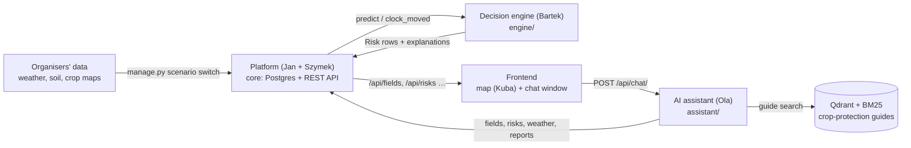

# Field Under Pressure — Architecture Overview

Nov 20, 2026 · @Szymon

Field Under Pressure is a farmer dashboard for maize and winter wheat: an interactive map of a farm's fields and their crop risks, plus an AI assistant grounded in the official crop-protection guides. This document only defines the components and how they relate; interfaces, data model and implementation belong in each component's own documentation.

## Product

A farmer opens one screen and sees their farm: each field on a map with its crop and how risky the coming days are for it. From there they can:

- follow how risk for each threat develops over the season, field by field;
- ask the assistant why a field is at risk and what to do, with answers that cite the official guides;
- ask for summaries and charts about their fields;
- report what they see in the field (for example, signs of disease), which is stored and taken into account.

The demo replays a past season as if it were today; the same design is meant to run on live weather data.

## System overview

The platform connects everything: data comes in through it, the decision engine and the assistant work against it, and the frontend presents it to the farmer.

## Components

The system has five components, each with one owner who writes its documentation.

**Platform** (Jan + Szymek). The backbone: the database, the Django backend, the interfaces between components, and the integration of the hackathon datasets (and live weather data). It is the single source of truth that every other component reads from and writes to.

**Frontend** (Jan + Szymek). The web application the farmer uses. It hosts the map and the chat panel and connects them to the platform.

**Map** (Kuba). The interactive map of the farm: fields, their crops, their risk per threat, how that risk changes over the season, and the details of a selected field.

**Decision engine** (Bartek). Turns each field's data into risk assessments per threat and day, each with an explanation of why. It may combine rules from the guides, ML models and agents.

**AI assistant** (Ola). The chatbot. It answers from the official guides (RAG) and from the platform's data (through MCP): it explains risks, answers questions with citations, produces summaries and charts, and records the farmer's observations.

## How the components work together

The platform sits in the middle: the decision engine writes risk into it, and the map and the assistant read the same results. The main flow:

1. The platform brings the farm's data in: fields, crops, soil, weather.
2. The decision engine assesses each field and stores risks with their explanations.
3. The map shows those risks; the assistant explains them, using the same results plus the guides.
4. When the farmer reports an observation to the assistant, the platform stores it, the decision engine reassesses that field, and the map updates.

Shared principles:

- **One source of truth.** Everything the farmer sees comes from the platform.
- **Every risk is explainable.** The map and the assistant show the same reasons for a risk.
- **Historical demo, live-ready.** The demo runs on a past season; nothing in the design depends on that.
- **Grounded assistant.** It cites the guides and the data, and gives no product or dose advice.

## Out of scope

This overview deliberately leaves out interfaces, the data model, technology choices and implementation. Jan and Szymek define the database, the interfaces and the Django integration; every owner documents their own component on top of that.
