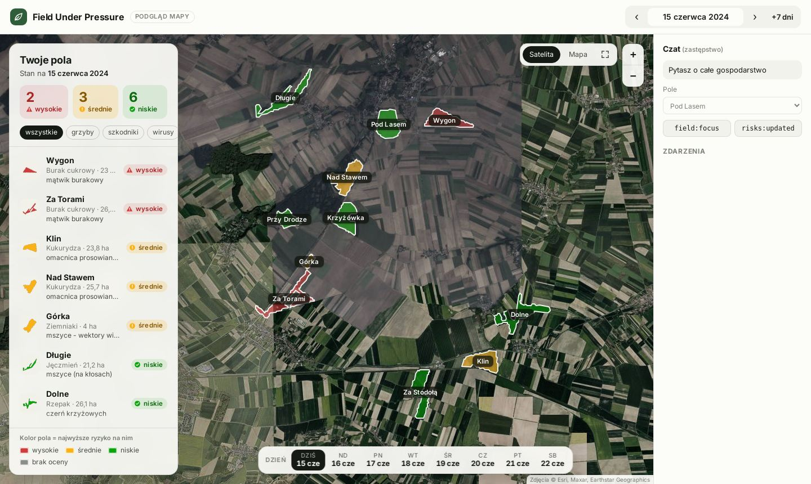
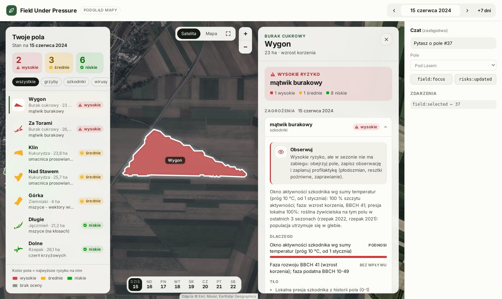
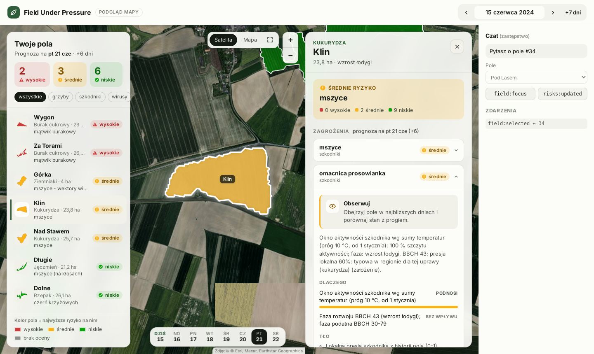

# Map + engine: notes for the team

> **Historical document (notes of 21 Nov, before the platform API was merged).** Kept for the decisions and their reasons. Current behaviour: [interfaces.md](../interfaces.md) (the demo date moves only through `core.clock.set_today()`; chat messages carry `chart` and `pending_action`; engine texts are Polish) and [audit-2026-11-21.md](../audit-2026-11-21.md).

Bartek · branch `feat/map` · 21 Nov 2026

What is on `feat/map`, how to run it, and what each of us needs to know or do. The contract is still
[interfaces.md](../interfaces.md) and [database.md](../database.md); this page explains how the map and the engine follow
it, and lists the few points we still have to agree on.



## What is on the branch

| Piece | Where | State |
|-------|-------|-------|
| **Map module** `initMap(container, ctx): void` | `frontend/src/map/` | built, per interfaces.md and the map README; light + dark, phone layout |
| Event bus (verbatim from interfaces.md) | `frontend/src/events.ts` | built (file owned by Jan + Szymek: same code as the contract) |
| **Stand-in platform API** (dev only) | `engine/management/commands/engine_mock_api.py` | the agreed endpoints and shapes from the real database; not wired into Django's URLs |
| Dev page (stand-in for `main.ts` + chat) | `frontend/src/map/dev/` | date control, buttons that send the chat's events, event log |
| **Engine explanations in Polish** | `engine/` | every text that reaches the farmer (v0.11) |
| `predict()` contract from the review | `engine/compute.py` | merged into `main` already (`PredictResult`, `clock_moved`, `precompute_season`) |
| Demo farm 2024 | `engine_dev_seed --crop-from-map` | 11 fields near Krapkowice, 7 crops, crop from the 2024 crop map |

## Run it

```bash
docker compose up -d && python manage.py migrate
python manage.py engine_dev_seed --season 2024 --today 2024-06-15 --crop-from-map --fields-per-crop 2
python manage.py predict --season                 # previous season, then this one (about 35 s)
cd frontend && npm install && npm run map:dev && cd ..
python manage.py engine_mock_api                  # http://127.0.0.1:8001/  (--host 0.0.0.0 to open it on the LAN)
python manage.py test engine core                 # 93 tests
```

Move the demo date with the header control on the dev page, or `python manage.py engine_set_date 2024-06-20`.

## How the map works

- **Fields** are coloured by their highest risk level that day (`low` / `medium` / `high`, cut-offs 0.33 / 0.66),
  always with an icon and a label, never colour alone. Tiles above the list filter by level; chips filter by threat
  category.
- **Click a field** (on the map or in the list): the panel opens and the map sends `field:selected { fieldId }`.
  Clicking empty map or closing the panel sends `{ fieldId: null }`.
- **Field panel** ("why"): for each threat the action first (what to do, the spraying window for `treat`), then the
  summary, the drivers sorted by `effect` (`null` = context), growth stage and confidence. Low threats are grouped.
  Below: the season chart, crop history and soil.
- **Day strip** at the bottom: today + the coming days (`ctx.clock.forecastDays`). A click shows that day on the
  map and in the panel; it **does not move the demo date** (no write, no recompute). The header's date control
  does: `PUT /api/clock/`, then `date:changed`.
- **Season chart**: solid up to today, dashed for the coming days, level bands, hover for values.
- Handles `field:focus` (zoom, highlight, then `field:selected`), `date:changed` (back to today, reload) and
  `risks:updated` (reload those fields, with a short pulse).



### What the map reads

Only through `ctx.api`, only the agreed endpoints: `/api/fields/`, `/api/fields/{id}/`, `/api/risks/?date=`,
`/api/fields/{id}/risks/?to=today+7`, `/api/fields/{id}/risks/{date}/`, `/api/threats/`. From `explanation` it reads
exactly the map's keys in database.md ("Who reads what"): `level`, `summary`, `drivers` (`label`, `effect`),
`action` (`type`, `text`, `spray_window.date`), `growth_stage.name`, `confidence`. It never reads the browser's date.

### The coming days: where the forecast comes from

There is no forecast in the organisers' data. The seed fills `WeatherForecastDaily` with a copy of the observed
days (issued on D: the weather of D+1 … D+7, rain from IMERG). For today + 1 … + 7 the engine uses the weather
observed up to today, then the forecast issued today (daily values only), so those days are less precise and their
confidence drops by 6 % per day ahead. A live forecast (Open-Meteo, IMGW) can be written into the same table; Open-Meteo
also has archived real forecasts if we want an honest demo.



## To do / to agree, per person

### Jan + Szymek (platform)

1. **`ctx.api` method names.** interfaces.md doesn't name them. The map calls `getThreats()`, `getFields()`,
   `getField(id)`, `getRisks(date)`, `getFieldRisks(id, {from, to})`, `getFieldDayRisks(id, date)` (`MapApi` in
   `frontend/src/map/contract.ts`). If `api/client.ts` uses other names, only these calls change.
2. **`level` in `GET /api/risks/?date=`** (your decision 10): the map uses it when present; until then it derives
   the level from the score with the agreed cut-offs (same result).
3. **Demo date:** after saving the Clock, `PUT /api/clock/` and `ClockAdmin.save_model` call
   `engine.clock_moved(old, new)`. There is no signal any more; without the call the coming days stay computed for
   the old date. About 1.5 s for 11 fields.
4. **Seed:** `engine.precompute_season()` once (previous season first, for the carry-over), and fill the forecast's
   `total_precipitation` from IMERG.
5. **`main.ts`:** call `initMap(container, ctx)` once; the template must link `dist/main.css` (the map's and
   Leaflet's styles, emitted by esbuild). `ctx.clock` is updated in place, as plan B2 says.
6. **Types:** `frontend/src/map/contract.ts` holds the response types written from interfaces.md's examples, until
   `api/schema.d.ts` is generated; then import from there.
7. **Docs:** the open point "the engine writes English" in database.md / interfaces.md can be closed. The soil
   example in interfaces.md (`clay: 18.2`) predates the fractions decision.
8. `engine_mock_api` follows your implementation plan where interfaces.md is silent (default `from` = 1 September of
   the year before; any valid date accepted by PUT; 503 without a Clock row; strict `YYYY-MM-DD`). Delete it once your
   API is in.

### Ola (assistant)

- `predict()` returns a `PredictResult`: an `int` (rows written) with `.field_ids`, every field it rewrote,
  including nearby fields a symptoms report spread to. Return those as `updated_field_ids`.
- Explanations are Polish now: `summary` starts "Wysokie ryzyko – <zagrożenie>: …"; dates in texts are DD.MM.YYYY;
  keys and codes are unchanged (you read keys only, so nothing breaks).
- The map sends `field:selected { fieldId: null }` also when the panel is closed, so "Pytasz o: …" clears.
- Reports go to `core.Observation`; a report in both tables counts once (by `idempotency_key`).

### Kuba (map)

- The map module is built; entry `frontend/src/map/index.ts`, panel `panel.ts`, chart `chart.ts`, styles `map.css`
  (all rules under `.fup-map`, container queries for the layout). See the "Development" section of the map README.

### Everyone

- Fields are drawn once at import (no field boundaries in the data); the user can't add or edit fields in this
  contract. Adding that means new endpoints (`POST /api/fields/`) and a drawing mode: talk to Szymek first.
- Crop names from the API are English (`CropClass`); the map shows Polish names for the engine's crops.

## Engine facts that help others

| Need | Call / fact |
|------|-------------|
| Recompute after a report | `predict(field_ids=[id], start=observed_on)`; default `end` reaches the precomputed days |
| Recompute after a crop change | `predict(field_ids=[id], start=season start)` |
| Demo date moved | `clock_moved(old, new)` recomputes `(min, max + 7]` only |
| Fill the season | `precompute_season()` or `python manage.py predict --season` |
| Check the data | `python manage.py engine_check_data` |
| A day's ranking / summary | `engine.summary.farm_ranking(day)`, `field_day(field_id, day)` |
| "What if" for the chat | `engine.what_if(field_id, day, [Report(...)])` (nothing written) |
| Level cut-offs | 0.33 / 0.66; `explanation.level` is the truth |
| Score meaning | an index of how favourable the recent days were, not a probability |

Full engine reference: [engine/README.md](../../engine/README.md); history: [engine/CHANGELOG.md](../../engine/CHANGELOG.md).

## Known deviations from the contract (all small, all deliberate)

1. Response types are hand-written until the schema exists (contract says generated).
2. Without `level` in `/api/risks/`, the colour comes from the score with the agreed cut-offs.
3. Closing the panel also sends `field:selected { fieldId: null }` (null = no field selected).
4. `events.ts` and the `leaflet` dependency sit in files the platform owns (contract code, plan B0 dependency).


