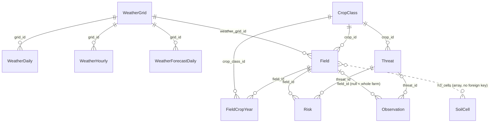

# Database

Field Under Pressure · owners: Jan + Szymek · last updated 20 Nov 2026

This document defines every table of the platform. Each section is marked **Certain** (agreed, build against it) or **Open** (not decided yet; see [Open questions](#open-questions)). All farm data tables are Django models in [`core/models.py`](../core/models.py); other components import them and never create their own migrations. Need a table or column? Ask Jan or Szymek. The one exception is the assistant's chat tables, which live in the `assistant` app and belong to Ola (see [interfaces.md](interfaces.md#chat-tables)). How the components use these tables is in [interfaces.md](interfaces.md).

## Principles

- **Source names and source units.** Columns copied from a dataset keep the dataset's column name and unit. Nothing is converted at import (the one possible exception is soil, see [SoilCell](#soilcell)). Every unit is listed below, and also in each column's help text in the code and in `/admin/`.
- **One "today".** The demo replays a past season. The current date always comes from `core.clock.today()`, never from `date.today()`.
- **No future weather.** Observed weather is only read up to `today()`. The next 7 days come from the forecast table.
- **Geometry is resolved once, at import.** Each field stores the weather cell, soil cells and crop shares that belong to it. After import everything is a plain key lookup; nothing does geometry at runtime (no PostGIS).
- **Import only what the farm needs.** Weather and soil are loaded only for the cells under the demo farm's fields. Small lookup tables (weather grid, crop classes) are loaded in full.

## Overview

| Table | Status | Comes from | Rough size |
|-------|--------|------------|------------|
| [Clock](#clock) | Certain | set by the seed | 1 row |
| [WeatherGrid](#weathergrid) | Certain | weather `grid_table` | ~20,000 (all of Poland) |
| [WeatherDaily](#weatherdaily) | Certain | weather `daily_table` + IMERG daily | farm cells × 6 years × 365 |
| [WeatherHourly](#weatherhourly) | Certain | weather `hourly_table` + IMERG hourly | farm cells × 6 years × 8,760 |
| [WeatherForecastDaily](#weatherforecastdaily) | Certain | seeded from WeatherDaily | 7 × the season's daily rows |
| [SoilCell](#soilcell) | Certain | soil parquet (ISRIC Soil 250 v2) | H3 cells under the fields (hundreds) |
| [CropClass](#cropclass) | Certain | cropland legend (CLMS Crop Types) | 21 |
| [Field](#field) | Certain (core columns) | drawn by us + derived at import | a handful |
| [FieldCropYear](#fieldcropyear) | Certain | cropland rasters 2020–2024 | fields × 5 years × a few classes |
| [Threat](#threat) | Certain | `ryzyka_zebrane.xlsx` (sheets `kukurydza`, `pszenica`) | ~40 |
| [Observation](#observation) | Certain | farmer reports, through the assistant | a few per field |
| [Risk](#risk) | Certain (except `explanation` format) | decision engine | fields × threats × season days |



`Clock` stands alone and has no relations.

## Time: today, observed weather and forecast

- `Clock` holds exactly one row with the current date of the demo. It is never empty and there is no fallback to the real date. The seed creates it; moving the demo forward means updating that row (by hand in `/admin/`, or by a daily job).
- `core.clock.today()` returns that date and raises `ClockNotSetError` if the row is missing. `core.clock.FORECAST_DAYS` is 7.
- **Observed** weather means `date <= today()`. Always read it through `WeatherDaily.objects.observed()` / `WeatherHourly.objects.observed()`.
- **Forecast** means the 7 days after today: `WeatherForecastDaily` rows with `issued_on = today()`, read through `WeatherForecastDaily.objects.current()`.
- **Risks** split the same way: `Risk.objects.season_so_far()` (`date <= today()`) and `Risk.objects.coming_days()` (today + 1 … today + 7).
- The forecast is seeded in advance for every day of the season, so moving the clock is instant.

### How the demo is filled

The demo replays a past season, and the whole season is loaded up front:

1. **Observed weather** (`WeatherDaily`, `WeatherHourly`) for every day of the season, for the farm's grid cells.
2. **Forecast** (`WeatherForecastDaily`): for every day D of the season, the observed rows for D + 1 … D + 7 are copied with `issued_on = D`. The weather packages have no precipitation of their own, so the forecast's `total_precipitation` is filled from the observed day's `imerg_total_precipitation`; otherwise the engine's spraying window cannot check for rain. In a live system a real forecast would be written here instead.
3. **Risks** (`Risk`): `predict()` runs once over the whole season, each day as of that day.
4. **Clock**: set to the day the demo starts.

So the database always contains rows dated after the demo's today. They stay hidden in two places:

- **in Python code**, by the query helpers above, which never return anything after today (weather) or today + 7 (forecast, risks);
- **for the frontend**, by the API, which refuses or cuts off any date after today + 7 ([interfaces.md](interfaces.md#no-data-after-the-forecast)).

Moving the demo date (`PUT /api/clock/`, or `/admin/`) moves both limits; nothing needs recomputing.

## Rules for every component

1. **The date is `core.clock.today()`,** never `date.today()` or `timezone.now()`. In the frontend, it is the date the API reports, never the browser's `new Date()`.
2. **Observed weather is read through `.observed()`, the forecast through `.current()`.** Never filter weather by date yourself without them.
3. **Each table has one writer** (below). Everyone else only reads it.
4. **Values are stored in source units.** Convert in your own code when a rule needs another unit (e.g. wind km/h → m/s), never in the database.
5. **Refer to threats by `code`** (e.g. `wheat.septoria_leaf_blotch`), never by `id`: ids differ between databases. Use `CropClass.WHEAT` / `CropClass.MAIZE` instead of raw codes.
6. **Schema changes go through Jan or Szymek.** Nobody else adds models or migrations to `core`. The chat tables in `assistant` are Ola's.

| Table | Written by | Read by |
|-------|------------|---------|
| Clock | platform (seed), anyone by hand in `/admin/` | everyone |
| WeatherGrid, WeatherDaily, WeatherHourly, SoilCell, CropClass, Field, FieldCropYear, Threat | platform (seed / import) | everyone |
| WeatherForecastDaily | platform (seeded from WeatherDaily) | everyone |
| Risk | decision engine (`predict()`) | map (via API), assistant |
| Observation | assistant, only through its "record an observation" tool (by hand in `/admin/` for testing) | decision engine, assistant |
| Conversation, Message (`assistant` app) | platform chat endpoint | chat window (via API), assistant |

## Using the models

The helpers below are the supported way to read and write. They all live in [`core/models.py`](../core/models.py) and [`core/clock.py`](../core/clock.py).

| Helper | Returns |
|--------|---------|
| `clock.today()` | The demo's current date. Raises `clock.ClockNotSetError` if the Clock row is missing |
| `clock.FORECAST_DAYS` | 7 |
| `WeatherDaily.objects.observed()` | Daily weather up to and including today |
| `WeatherHourly.objects.observed()` | Hourly weather up to and including today |
| `WeatherForecastDaily.objects.current()` | The forecast issued today: today + 1 … today + 7 |
| `Risk.objects.season_so_far()` | Risks up to and including today |
| `Risk.objects.coming_days()` | Risks for today + 1 … today + 7 |
| `field.soil_cells()` | The SoilCell rows under the field (average them) |
| `field.crop_years` | The field's FieldCropYear rows (crop history) |
| `field.risks` / `threat.risks` | Related risks; `.season_so_far()` and `.coming_days()` work on them too |

`.observed()` and `.current()` take an optional `as_of` date (default `clock.today()`), so the engine's `predict()` can work through a whole season one day at a time: `WeatherDaily.objects.observed(as_of=day)`, `WeatherForecastDaily.objects.current(as_of=day)`. Only the engine passes it. See [interfaces.md](interfaces.md#as_of-on-the-helpers).

```python
from datetime import timedelta

from core import clock
from core.models import CropClass, Field, Risk, Threat, WeatherDaily, WeatherForecastDaily

today = clock.today()
field = Field.objects.get(name="North field")

# Inputs for one field
last_two_weeks = WeatherDaily.objects.observed().filter(grid=field.weather_grid, date__gt=today - timedelta(days=14))
forecast = WeatherForecastDaily.objects.current().filter(grid=field.weather_grid).order_by("date")  # 7 rows
soil = field.soil_cells()
previous_crops = field.crop_years.filter(year__lt=today.year).order_by("year", "-share")
threats = Threat.objects.filter(crop=field.crop)

# Writing a risk (engine only): one row per field, threat and day, overwritten
Risk.objects.update_or_create(
    field=field,
    threat=Threat.objects.get(code="wheat.septoria_leaf_blotch"),
    date=today,
    defaults={"score": 0.72, "explanation": {"summary": "..."}},
)

# Reading risks (map, assistant)
history = field.risks.season_so_far().select_related("threat").order_by("date")
coming = field.risks.coming_days().select_related("threat").order_by("date")
```

Many risks at once (season backfill), as one upsert instead of a loop:

```python
Risk.objects.bulk_create(
    rows,  # list of unsaved Risk objects
    update_conflicts=True,
    unique_fields=["field", "threat", "date"],
    update_fields=["score", "explanation", "computed_at"],
)
```

The database rejects a score outside 0–1, a crop share outside 0–1, a forecast date outside issue + 1 … + 7, and a second Clock row.

## How positions work

Every dataset value belongs to a cell; a field is our own polygon laid over those cells. The cells are either much larger than a field (take one) or much smaller (count the ones inside), so no partial-overlap percentages are needed.

| Dataset | Cell | Cell size | Cells in a 20 ha field | How a field gets its values |
|---------|------|-----------|------------------------|-----------------------------|
| Weather | 4 km grid square, given as its centre point | 16 km² = 1,600 ha | less than one | The grid point nearest the field's centroid → `Field.weather_grid` |
| Soil | H3 hexagon, level 10 | ~1.5 ha (sides ~66 m) | ~13 | Hexagons whose centre lies inside the polygon → `Field.h3_cells`; average them (all hexagons have the same area). If none, the hexagon under the centroid |
| Cropland | raster pixel, 10 m | 0.01 ha | ~2,000 | Count the pixels inside the polygon per class → `FieldCropYear.share` |

Soil was mapped at 250 m (6.25 ha), so about four neighbouring hexagons carry identical values.

## Tables

Types are Django field types. "null" means the column is nullable.

### Clock

**Certain.** Exactly one row; a database check keeps `id = 1`.

| Column | Type | Unit | Notes |
|--------|------|------|-------|
| `id` | integer, primary key | – | Always 1 |
| `today` | `DateField` | local date | The demo's current date. Never null, no default |

### WeatherGrid

**Certain.** Source: weather `grid_table` ([weather.md](../field-under-pressure-materials/data/weather.md)). Loaded for all of Poland.

| Column | Type | Unit | Notes |
|--------|------|------|-------|
| `grid_id` | `CharField`, primary key | – | Source id. Foreign keys to this table are named `grid`, so their database column is literally `grid_id` |
| `lat` | `FloatField` | ° (WGS84) | Grid point |
| `lon` | `FloatField` | ° (WGS84) | Grid point |
| `geohash4` | `CharField` | – | Geohash, precision 4 |
| `time_zone` | `CharField` | – | Europe/Warsaw throughout Poland |

Not stored: `geom` (the same point as `lat`/`lon`).

### WeatherDaily

**Certain.** Source: weather `daily_table`, plus IMERG `imerg_precipitation_daily` merged into the same row.

- Key: `grid` + `date`, unique.
- `date` is the local calendar date (Europe/Warsaw); daily values aggregate the 24 local hours 00:00–23:00.
- Every weather column is a nullable `FloatField`: the source sets out-of-range values to null.

| Column | Type | Unit | Notes |
|--------|------|------|-------|
| `grid` | `ForeignKey(WeatherGrid)` | – | Column `grid_id` |
| `date` | `DateField` | local date | |
| `max_temperature`, `min_temperature`, `avg_temperature` | float, null | °C | Max / min / mean of 24 hourly values, 2 m |
| `midpoint_temperature` | float, null | °C | (min + max) / 2 |
| `max_dew_point_temperature`, `min_dew_point_temperature`, `avg_dew_point_temperature` | float, null | °C | |
| `total_precipitation` | float, null | mm/day | Sum of 24 hourly values (weather model). **Empty in the hackathon packages:** use `imerg_total_precipitation` |
| `imerg_total_precipitation` | float, null | mm/day | From IMERG (satellite), renamed from `total_precipitation` |
| `max_wind_speed`, `min_wind_speed`, `avg_wind_speed` | float, null | **km/h** | 10 m |
| `avg_wind_direction` | float, null | ° azimuth | 10 m, vector average |
| `max_wind_gust` | float, null | km/h | 10 m |
| `max_wind_speed_2m`, `min_wind_speed_2m`, `avg_wind_speed_2m` | float, null | km/h | 2 m |
| `max_relative_humidity`, `min_relative_humidity`, `avg_relative_humidity` | float, null | % (0–100) | |
| `total_downward_solar_radiation`, `total_net_solar_radiation` | float, null | MJ/m²/**day** | Daily totals |
| `max_downward_solar_radiation`, `max_net_solar_radiation` | float, null | MJ/m²/**hour** | Highest hourly value of the day |
| `min_atmospheric_pressure`, `max_atmospheric_pressure`, `avg_atmospheric_pressure` | float, null | mbar (= hPa) | Surface |
| `avg_total_cloud_cover` | float, null | **fraction 0–1** | |
| `avg_snow_depth` | float, null | mm **water equivalent** | Not snow height |
| `avg_snow_density` | float, null | kg/m³ | |
| `max_soil_temperature_level_1` … `_level_4` | float, null | °C | 4 columns; weather soil levels, see below |
| `min_soil_temperature_level_1` … `_level_4` | float, null | °C | 4 columns |
| `avg_soil_temperature_level_1` … `_level_4` | float, null | °C | 4 columns |
| `avg_soil_moisture_level_1` … `_level_4` | float, null | m³/m³ (**fraction 0–1**) | 4 columns, volumetric water |
| `eto` | float, null | mm/day | Grass reference evapotranspiration |
| `etr` | float, null | mm/day | Alfalfa reference evapotranspiration |
| `day_length` | float, null | h | |

Weather soil levels: level 1 = 0–7 cm, level 2 = 7–28 cm, level 3 = 28–100 cm, level 4 = 100–289 cm.

### WeatherHourly

**Certain.** Source: weather `hourly_table`, plus IMERG `imerg_precipitation_hourly` merged into the same row.

- Key: `grid` + `utc_time`, unique. Index on `grid` + `date`.
- Not stored: `local_time`. Django shows `utc_time` in Europe/Warsaw; storing both invites daylight-saving bugs.

| Column | Type | Unit | Notes |
|--------|------|------|-------|
| `grid` | `ForeignKey(WeatherGrid)` | – | Column `grid_id` |
| `utc_time` | `DateTimeField` (time-zone aware) | UTC | Start of the hour |
| `date` | `DateField` | local date | For fast filtering |
| `temperature` | float, null | °C | 2 m |
| `dew_point_temperature` | float, null | °C | 2 m |
| `precipitation` | float, null | mm/hour | Weather model. **Empty in the hackathon packages:** use `imerg_precipitation` |
| `imerg_precipitation` | float, null | mm/hour | From IMERG (satellite), renamed from `precipitation` |
| `wind_speed` | float, null | km/h | 10 m |
| `wind_direction` | float, null | ° azimuth | 10 m |
| `wind_gust` | float, null | km/h | 10 m |
| `wind_speed_2m` | float, null | km/h | 2 m |
| `relative_humidity` | float, null | % (0–100) | |
| `downward_solar_radiation` | float, null | MJ/m²/hour | |
| `net_solar_radiation` | float, null | MJ/m²/hour | |
| `atmospheric_pressure` | float, null | mbar (= hPa) | |
| `total_cloud_cover` | float, null | fraction 0–1 | |
| `snow_depth` | float, null | mm water equivalent | |
| `snow_density` | float, null | kg/m³ | |
| `soil_temperature_level_1` … `_level_4` | float, null | °C | 4 columns |
| `soil_moisture_level_1` … `_level_4` | float, null | m³/m³ (fraction 0–1) | 4 columns |
| `eto` | float, null | mm/**hour** | |
| `etr` | float, null | mm/**hour** | |

### WeatherForecastDaily

**Certain.** The 7-day forecast as it was known on a given day. In the demo it is seeded from WeatherDaily: for every day D of the season, the observed rows for D+1 … D+7 are copied with `issued_on = D`. In a live system a job would write a real forecast here.

- Key: `grid` + `issued_on` + `date`, unique. `date` is between `issued_on + 1` and `issued_on + 7`.
- Columns: `grid`, `issued_on` (`DateField`), `date` (`DateField`, the day the forecast is for), then **every weather column of [WeatherDaily](#weatherdaily) except `imerg_total_precipitation`**, with the same names and units. IMERG is measured by satellite, so there is no forecast of it.
- All weather columns are nullable: a real forecast service will not provide every column (soil levels, for example).

### SoilCell

**Certain.** Source: soil parquet, ISRIC SoilGrids Soil 250 v2, 2022 ([soil.md](../field-under-pressure-materials/data/soil.md)). Static; one row per H3 cell.

| Column | Type | Unit | Notes |
|--------|------|------|-------|
| `h3_index_10` | `CharField`, primary key | – | H3 index, level 10 |

**Layered properties.** Column name `<property>_<depth>_mean`, for the depths `0_5cm`, `5_15cm`, `15_30cm`, `30_60cm`, `60_100cm`, `100_200cm` (for example `clay_0_5cm_mean`, `phh2o_15_30cm_mean`). All nullable `FloatField`s.

| Property | Meaning | Unit | Columns |
|----------|---------|------|---------|
| `bdod` | Bulk density of the fine earth | kg/dm³ | 5 (no `15_30cm` in the source) |
| `cec` | Cation exchange capacity | cmol(c)/kg | 6 |
| `cfvo` | Coarse fragments (> 2 mm), by volume | vol % | 6 |
| `clay` | Clay (< 0.002 mm) | % (g/100 g) | 6 |
| `sand` | Sand (> 0.05 mm) | % (g/100 g) | 6 |
| `silt` | Silt (0.002–0.05 mm) | % (g/100 g) | 6 |
| `nitrogen` | Total nitrogen | g/kg | 6 |
| `phh2o` | pH in water | pH | 6 |
| `ocd` | Organic carbon density | kg/m³ | 6 |
| `soc` | Soil organic carbon | g/kg | 6 |

**Single columns.**

| Column | Type | Unit | Notes |
|--------|------|------|-------|
| `ocs_0_30cm_mean` | `IntegerField`, null | t/ha | Organic carbon stock, 0–30 cm |
| `om` | float, null | g/kg (see check below) | Organic matter, root-zone average to 30 cm |
| `cec` | float, null | cmol(c)/kg | Root-zone average to 30 cm |
| `ph` | float, null | pH | Root-zone average to 15 cm. Source name `pH` |
| `sand`, `silt`, `clay` | float, null | **fraction 0–1** | Root-zone averages to 30 cm. The organiser docs say %, the real files hold fractions (0.18 = 18 %; found for sand and clay, silt assumed) |
| `bulk_density` | float, null | kg/dm³ | Root-zone average to 30 cm |
| `band_om` | `CharField`, null | `low` / `moderate` / `high` | Low (< 2) / moderate / high (> 3.5). Text in the real files. Source name `BAND_om` |
| `band_cec` | `CharField`, null | `low` / `moderate` / `high` | Low (< 10) / moderate / high (> 20). Source name `BAND_cec` |
| `band_ph` | `CharField`, null | `low` / `moderate` / `high` | Low (< 5.8) / moderate / high (> 7.5). Source name `BAND_pH` |
| `soil_texture` | `CharField`, null | – | USDA texture class, to 30 cm. Source name `soilTexture` |

Not stored: `hid` (a storage partition key with no meaning for us).

**Checks when the data arrives** (before anyone relies on these columns):

1. Raw SoilGrids files use scaled whole numbers (pH × 10, clay in g/kg, bulk density in cg/cm³, …). The organiser docs say the values are already converted. Expect pH about 4–8 (not 40–80), clay 0–100 (not 0–1000), bulk density about 1–1.7 (not 100–170). If the values are raw, the import divides them (pH, cec, cfvo, clay, sand, silt, soc, ocd by 10; bdod and nitrogen by 100), and this document is updated.
2. `om` is documented in g/kg, but the `band_om` cut-offs (2 and 3.5) look like percentages. Check real values.
3. Already found in the real files (decision engine): root-zone `sand` and `clay` are fractions, the `BAND_*` columns are text, and some column names differ from the docs (`soilTexture`, `pH`, `BAND_*`): rename them at import. Check `silt` and the layered columns the same way.

### CropClass

**Certain.** Source: CLMS Crop Types legend ([cropland.md](../field-under-pressure-materials/data/cropland.md)). All 21 codes are loaded.

| Column | Type | Unit | Notes |
|--------|------|------|-------|
| `code` | `PositiveIntegerField`, primary key | – | CLMS class code |
| `name` | `CharField` | – | English name from the legend |

The codes: 0 No cropland · 1110 Wheat · 1120 Barley · 1130 Maize · 1140 Rice · 1150 Other cereals · 1210 Fresh vegetables · 1220 Dry pulses · 1310 Potatoes · 1320 Sugar beet · 1410 Sunflower · 1420 Soybeans · 1430 Rapeseed · 1440 Flax, cotton and hemp · 2100 Grapes · 2200 Olives · 2310 Fruits · 2320 Nuts · 3100 Unclassified arable crop · 3200 Unclassified permanent crop · 65535 Outside area.

CLMS "Wheat" does not separate winter and spring wheat; we treat it as winter wheat.

### Field

**Certain (core columns).** Not in any dataset: the cropland data is a raster without field boundaries, and risks, the map and the weather and soil lookups all depend on a field. The polygons are drawn by us; the other columns are computed once at import.

| Column | Type | Unit | Notes |
|--------|------|------|-------|
| `id` | `BigAutoField`, primary key | – | |
| `name` | `CharField` | – | |
| `geometry` | `JSONField` | EPSG:4326 | GeoJSON `Polygon` or `MultiPolygon`. Coordinates are **[lon, lat]** |
| `area_ha` | `FloatField` | ha | Computed in a metric projection (EPSG:2180, the Polish national grid), never from degrees |
| `centroid_lat`, `centroid_lon` | `FloatField` | ° (WGS84) | |
| `weather_grid` | `ForeignKey(WeatherGrid)` | – | Grid point nearest the centroid |
| `h3_cells` | `ArrayField(CharField)` | – | H3 level-10 cells whose centre lies inside the polygon (or the centroid's cell if none). `field.soil_cells()` returns the matching [SoilCell](#soilcell) rows |
| `crop` | `ForeignKey(CropClass)` | – | This season's crop: the class with the largest share in this season's [FieldCropYear](#fieldcropyear) rows; can be corrected by hand |

**Open:** sowing date or growth stage. These wait for the decision engine's needs. Reports from the farmer (for example infestations) go into a separate `Observation` table, see [Open questions](#open-questions).

### FieldCropYear

**Certain.** Source: cropland rasters 2020–2024. For every field and year, the share of the field's pixels in each crop class. It shows the previous crops (the guides say the previous crop matters, for example wheat after maize raises fusarium risk), mixed fields and badly drawn polygons.

| Column | Type | Unit | Notes |
|--------|------|------|-------|
| `field` | `ForeignKey(Field)` | – | |
| `year` | `PositiveSmallIntegerField` | year | 2020–2024 |
| `crop_class` | `ForeignKey(CropClass)` | – | Includes code 0 (No cropland) |
| `share` | `FloatField` | fraction 0–1 | Pixels of this class ÷ all pixels inside the field. Database check: 0 ≤ share ≤ 1 |

- Key: `field` + `year` + `crop_class`, unique.
- The shares of one field and year add up to 1.

### Threat

**Certain.** Source: `ryzyka_zebrane.xlsx`, sheets `kukurydza` (maize) and `pszenica` (wheat), in [`metodyki/`](../field-under-pressure-materials/metodyki/). Loaded from a hand-checked fixture file, not parsed automatically: the sheets are free text in different layouts.

| Column | Type | Unit | Notes |
|--------|------|------|-------|
| `id` | `BigAutoField`, primary key | – | |
| `code` | `CharField`, unique | – | Stable name for the engine and the assistant, for example `wheat.septoria_leaf_blotch` |
| `crop` | `ForeignKey(CropClass)` | – | 1110 Wheat or 1130 Maize |
| `name` | `CharField` | – | Polish name, as in the source |
| `category` | `CharField` with choices | – | `fungal`, `bacterial`, `viral` or `pest` |
| `temperature_text` | `TextField`, blank | – | Favourable temperature, as written in the source |
| `temp_min_c`, `temp_max_c` | float, null | °C | Only where the source gives numbers (most wheat rows, e.g. "15-25"; maize rows are mostly descriptive, e.g. "Lata ciepłe") |
| `humidity_text` | `TextField`, blank | – | Favourable humidity / rain, as written |
| `other_factors` | `TextField`, blank | – | Other risk factors, as written |
| `growth_stage_text` | `TextField`, blank | – | When to watch for it (maize viral diseases and pests only) |
| `source` | `CharField` | – | Sheet name, e.g. `ryzyka_zebrane.xlsx / pszenica` |

The wheat sheet lists diseases only, no pests. Wheat pests would have to come from the PDF guide.

### Observation

**Certain.** A farmer's report about a field: something seen, done or known. Written only by the assistant's "record an observation" tool after the farmer confirms it; read by the decision engine, which recomputes the field from `observed_on` on ([interfaces.md](interfaces.md#writing-observations)). One row per report.

| Column | Type | Unit | Notes |
|--------|------|------|-------|
| `id` | `BigAutoField`, primary key | – | |
| `field` | `ForeignKey(Field)`, null | – | Empty = the whole farm / the area |
| `observed_on` | `DateField` | local date | The day the farmer saw or did it, not the day they told the chat |
| `recorded_at` | `DateTimeField` | UTC | When the report was stored |
| `kind` | `CharField` with choices | – | `symptoms`, `absence`, `neighbour`, `treatment`, `field_fact`, `event` (meanings below) |
| `category` | `CharField` with choices, blank | – | `disease`, `pest`, `weeds`, `damage`, `other`. Needed when no threat is named: symptoms of "some disease" raise every disease of the crop |
| `threat` | `ForeignKey(Threat)`, null | – | The threat, if the farmer named one of the crop's threats. Kept as empty if the threat is deleted |
| `severity` | float, null | fraction 0–1 | 0.3 low, 0.6 medium, 0.9 high. Database check: 0–1 |
| `distance_m` | float, null | m | Neighbour reports only. Database check: ≥ 0 |
| `details` | `JSONField` | – | Extra facts the engine reads: `sowing_date`, `tillage` (`plough` / `reduced`), `resistant_to` (threat codes), `type` (`hail` / `lodging` / `flood`), `scope` |
| `text` | `TextField`, blank | – | The farmer's own words (quoted in the explanation) |
| `idempotency_key` | `CharField`, unique, null | – | Same key = same report: no duplicates when the farmer confirms twice |

| `kind` | The farmer says | Engine effect (details: "Farmer reports" in [engine/README.md](../engine/README.md) on `feat/decision-engine`) |
|--------|-----------------|--------|
| `symptoms` | "I see brown rust on the north field" | that threat high for about 10 days; spreads to nearby fields of the same crop |
| `absence` | "Inspected, it's clean" | risk halved for about 10 days (empty threat = all threats) |
| `neighbour` | "My neighbour has head blight" | risk raised by closeness (`distance_m`) |
| `treatment` | "I sprayed against septoria on 10 May" | risk cut for about 14 days (empty threat = all fungal) |
| `field_fact` | "I sowed on 25 September", "I don't plough" | real sowing date / reduced tillage / resistant variety (`details`) |
| `event` | "Hail yesterday" | wound and lodging effects (`details.type`) |

- `Observation.objects.observed()` returns reports up to today (`as_of` like the weather helpers).
- `field.observations` lists a field's reports; whole-farm reports have no field.
- There is no link to the chat conversation here: `core` never depends on the `assistant` app. The assistant can put the conversation id in `details` if it needs it.

### Risk

**Certain.** Written by the decision engine; read by the map and the assistant.

| Column | Type | Unit | Notes |
|--------|------|------|-------|
| `id` | `BigAutoField`, primary key | – | |
| `field` | `ForeignKey(Field)` | – | |
| `threat` | `ForeignKey(Threat)` | – | |
| `date` | `DateField` | local date | The day this risk applies to |
| `score` | `FloatField` | 0–1, no unit | Database check: 0 ≤ score ≤ 1. An index of how favourable the recent days were for the threat, not a probability |
| `explanation` | `JSONField` | – | Why the score is what it is: [explanation format, version 1](#explanation-version-1) |
| `computed_at` | `DateTimeField` | UTC | Set on every write |

- Key: `field` + `threat` + `date`, unique. Index on `field` + `date`.
- **One row per field, threat and day, overwritten** whenever the engine recomputes it. Earlier calculations are not kept.
- Readers: the season so far is `Risk.objects.season_so_far()`; the coming days are `Risk.objects.coming_days()`. Rows further ahead may exist (the season can be precomputed) and are ignored until the clock reaches them.
- **Levels:** low < 0.33 ≤ medium < 0.66 ≤ high. The engine stores the level in `explanation.level`; readers show it rather than recomputing it.

#### Explanation, version 1

The engine writes this JSON in every row; the map's "why" panel and the assistant read it, and the API passes it through unchanged. It is the format the engine documents in [engine/README.md](../engine/README.md) ("What it writes"); this section is the contract. Readers ignore keys they don't know, so the engine can add keys without breaking anyone; renaming or removing a key needs a new `version`.

| Key | Type | Meaning |
|-----|------|---------|
| `version` | int | `1` |
| `summary` | text | One or two sentences: the level, the threat and the main reasons. Shown as it is |
| `level` | text | `low` / `medium` / `high` (cut-offs above) |
| `score` | float 0–1 | Same as the row's `score` |
| `threat` | object | `code`, `name_pl`, `name_en`, `category` |
| `as_of` | date | The day the row was assessed for (`YYYY-MM-DD`) |
| `crop` | object | `code` (CropClass) and `source`: `field` (this season's `Field.crop`) or `crop map` (a past season) |
| `growth_stage` | object | `bbch` (int), `name`, `method` (degree days / satellite / farmer's sowing date), `sowing_assumed` (date or null), `confidence` (0–1) |
| `drivers` | list | **Why**, one entry per factor (below). Not sorted: sort by `effect` to get the most important first |
| `action` | object | What to do (below) |
| `severity` | float 0–1 | Share of the yield at risk if the threat materialises (team assumption) |
| `expected_loss` | float 0–1 | `score × severity`; used to rank fields |
| `confidence` | float 0–1 | How sure the row is: growth-stage method × weather data quality × distance into the forecast; 1.0 when the farmer saw it |
| `confidence_observed`, `forecast_lead_days` | float, int | Only on days after today: the confidence before the forecast discount, and how many days ahead |
| `notes` | list of text | Agronomic notes for this threat |
| `assumptions` | object | The team's own numbers used by the rule (thresholds, hours) |
| `model`, `model_version` | text | `rules`, the engine's version |

**A driver** (entry of `drivers`):

| Key | Type | Meaning |
|-----|------|---------|
| `factor` | text | Stable name, e.g. `condition_hours`, `growth_stage`, `previous_crop`, `farmer_report`, `rain_days` |
| `label` | text | Human-readable sentence. Shown as it is |
| `value`, `unit` | number, text | Optional: the measured value and its unit |
| `threshold` | text | Optional: when it starts to count / counts fully |
| `multiplier` | float | Optional: the factor's multiplier on the score |
| `effect` | float or null | How much the score would drop without this factor; `null` = context only |
| `kind`, `observed_on`, `text` | text, date, text | Farmer reports only: the report's kind, date and the farmer's own words |

**The action:**

| Key | Type | Meaning |
|-----|------|---------|
| `type` | text | `wait` / `monitor` / `treat` |
| `text` | text | What to do, one sentence. Shown as it is |
| `threshold` | text or null | The monitoring / economic threshold for the current growth stage |
| `spray_window` | object or null | Only for `treat`: `date`, `quality` (`optimal` / `acceptable`), `conditions`, `rule`, `note`. From the forecast issued on `as_of` for a day up to today, and from the forecast issued today for a coming day |

**Text language.** `summary`, `drivers[].label`, `action.text`, `action.threshold` and `notes` reach the farmer as they are, so they must be **Polish**, like the rest of the interface. The engine writes them in Polish since v0.11 (engine/CHANGELOG.md); keys, codes and `threat.name_en` stay English.

**Who reads what.**

| Reader | Uses |
|--------|------|
| Map ("why" panel, colours) | `level` for the colour, `summary`, `drivers` (`label`, `effect`), `action` (`type`, `text`, `spray_window.date`), `growth_stage.name`, `confidence` |
| Assistant | `summary`, the top `drivers` by `effect`, `action`, `growth_stage`, `confidence` (already on `feat/chat-assistant`) |
| Engine (`engine.summary`) | `level`, `expected_loss`, `action`, `summary` |

No product names or doses appear anywhere (shared principle).

## Unit traps

- **Wind is in km/h.** Most spraying and disease rules quote m/s: divide by 3.6.
- **Percent vs fraction.** Relative humidity is 0–100 %; cloud cover, soil moisture, soil sand / silt / clay and report severity are fractions 0–1.
- **Radiation.** Daily totals are MJ/m²/day; the daily `max_*` columns and all hourly values are MJ/m²/hour. 1 MJ/m²/hour ≈ 277.8 W/m².
- **Evapotranspiration** is mm/day in the daily tables and mm/hour in the hourly table.
- **Snow depth** is mm of water equivalent, not snow height.
- **Two soil-depth systems.** Weather `level_1` … `level_4` (0–7, 7–28, 28–100, 100–289 cm) are not the SoilGrids depths (0–5 … 100–200 cm).
- **Time.** Daily `date` is the local (Europe/Warsaw) day; hourly `utc_time` is UTC.
- **Area** is computed in metres (EPSG:2180), never from degrees.
- **Coordinate order.** GeoJSON is [lon, lat]; most of the datasets and code use lat, lon.

## Known issues in the datasets

Found by the decision engine in the real files; the import has to handle them:

- **No precipitation in the weather packages:** `total_precipitation` / `precipitation` are empty; rain comes only from IMERG.
- **Weather grid** `lat` / `lon` are decimals: cast to float.
- **Hourly weather:** `utc_time` has no time zone (it is UTC: make it aware); consecutive year files overlap by one hour (skip the duplicates).
- **Soil:** see the checks under [SoilCell](#soilcell).
- **Cropland:** the 2021 map is identical to 2022. Store it, but `FieldCropYear` for 2021 is wrong.
- **File names:** voivodeships without Polish letters; some packages spell `Łódzkie` as `odzkie` and `Małopolskie` as `Maopolskie`.

## Open questions

| Topic | Question | Who |
|-------|----------|-----|
| Explanation texts in Polish | Done (engine v0.11): every text in the explanation is Polish. | Bartek |
| Level names | The engine writes `medium`; the frontend's `risk.ts` uses `mid`. The frontend switches to `medium` | Jan + Szymek (frontend) |
| Field state | Farmer reports: done ([Observation](#observation)). Still open: the engine also proposes facts stored on the field itself (`Field.sowing_date`, `Field.tillage`, `Field.resistant_to`, `FieldCropYear.source`); it reads them if they exist. Until then `field_fact` reports do the same job | Bartek, Ola, Jan + Szymek |
| Hourly forecast | Does the engine need an hourly forecast table as well as the daily one? | Bartek |
| Satellite | If the engine uses Sentinel-2, add a per-field table (field, date, mean NDVI, cloud share). The organisers don't host this data | Bartek |
| Assistant storage | Where the RAG index of the guide PDFs lives (pgvector is available in our Postgres). Chat history is agreed: `Conversation` and `Message` in the `assistant` app | Ola |
| Threat names | Do threats need English names for the interface? | All |
| Data checks | After download: soil units and `om` (see [SoilCell](#soilcell)); `weather.md` lists no hourly 2021 folder although it states 2020–2025 coverage | Jan, Szymek |
| Threat catalogue | The engine has rules for 76 threats of 7 crops (`engine/catalog.py` on `feat/decision-engine`), far more than the spreadsheet's maize and wheat. Load Threat from the engine's codes (`engine_load_threats`), or write the fixture with exactly those codes? | Jan + Szymek, Bartek |

## Not stored

- Cropland rasters (only the per-field shares in FieldCropYear are kept).
- Guide PDFs (read from the materials submodule; the assistant owns its RAG index).
- Weather `geom`, hourly `local_time` and soil `hid` (redundant).
- Weather and soil for cells outside the demo farm.
