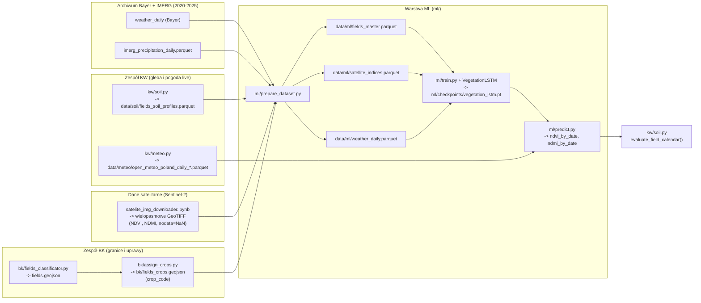

# Specyfikacja danych i modelu neuronowego (`VegetationLSTM`)

Dokument opisuje strukturę katalogu `ml/`, kontrakty danych wejściowych łączących pracę całego zespołu oraz architekturę sieci neuronowej **PyTorch LSTM** prognozującej wskaźniki **NDVI** i **NDMI** na **7 dni w przód** na podstawie **8 tygodni (56 dni) historii** (zgodnie z sekcją 3 koncepcji MVP).

---

## 1. Przepływ danych w projekcie



---

## 2. Struktura katalogu `ml/`

| Plik | Rola |
|---|---|
| `ml/__init__.py` | Eksport głównych klas, konfiguracji i funkcji inferencji |
| `ml/config.py` | Stałe (`HISTORY_DAYS=56`, `FORECAST_DAYS=7`), mapowanie kodów upraw CLMS (`1110`, `1130`, `1430`), definicje kolumn i indeksów skalowania, klasy `ModelConfig` i `TrainConfig` |
| `ml/prepare_dataset.py` | Adaptery budujące trzy kanoniczne pliki Parquet w `data/ml/` z artefaktów zespołu (`bk/`, `satelite_img_downloader.ipynb`, `kw/`, Bayer+IMERG) oraz generator danych `--demo` |
| `ml/dataset.py` | `FeatureScaler` (czysty NumPy, dopasowywany wyłącznie na zbiorze treningowym), sklejanie osi dziennej (`build_field_daily_series`), `FieldTimeSeriesDataset` oraz `split_indices` (podział po polach lub czasie) |
| `ml/model.py` | Sieć `VegetationLSTM` (Encoder–Decoder LSTM + kondycjonowanie statyczne + połączenie rezydualne) oraz zamaskowana funkcja straty `masked_smooth_l1_loss` i metryki MAE/RMSE |
| `ml/train.py` | Pętla treningowa z AdamW, `ReduceLROnPlateau`, obcinaniem gradientów, wyborem urządzenia (`cuda`/`mps`/`cpu`) i zapisem samowystarczalnego checkpointu `.pt` |
| `ml/predict.py` | Wczytywanie checkpointu (`load_trained_model`) i prognoza 7-dniowa (`predict_field_7days`) w formacie gotowym dla `evaluate_field_calendar` |
| `ml/DATA_AND_MODEL_SPEC.md` | Niniejsza dokumentacja |

---

## 3. Kontrakt danych wejściowych (`data/ml/`)

Pipeline treningowy oczekuje trzech znormalizowanych tabel Parquet w katalogu `data/ml/` (tworzonych przez `ml/prepare_dataset.py`). Dzięki wspólnemu schematowi model trenuje się na archiwum **Bayer (2020–2025)**, a w produkcji na **2026 r.** korzysta bez zmian z prognoz **Open-Meteo** z `kw/meteo.py`.

### 3.1. `data/ml/fields_master.parquet` (cechy statyczne pól)
Źródło: połączenie `bk/fields_crops.geojson` (`bk/assign_crops.py`) oraz `data/soil/fields_soil_profiles.parquet` (`kw/soil.py`) po kluczu `field_id` (dla pól o `area_ha >= 3.0`).

| Kolumna | Typ | Jednostka / wartości | Rola |
|---|---|---|---|
| `field_id` | `string` | np. `"field_0"` | Główny klucz łączenia wszystkich tabel |
| `area_ha` | `float` | ha (`>= 3.0`) | Cecha statyczna (przed skalowaniem przekształcana przez `log1p`) |
| `centroid_lat` | `float` | WGS84 | Do dopasowania najbliższej komórki pogody Bayer / Open-Meteo |
| `centroid_lon` | `float` | WGS84 | Do dopasowania najbliższej komórki pogody Bayer / Open-Meteo |
| `crop_code` | `float / int` | kod CLMS lub `NaN` | Surowy kod z `bk/assign_crops.py` |
| `crop` | `string` | `"pszenica"`, `"kukurydza"`, `"rzepak"`, `"inne"` | Mapowanie: `1110 -> pszenica`, `1130 -> kukurydza`, `1430 -> rzepak`, reszta / `NaN -> inne` |
| `sand_pct`, `silt_pct`, `clay_pct` | `float` | `%` (0–100) | Tekstura gleby z ISRIC SoilGrids |
| `ph` | `float` | pH | Odczyn gleby |
| `om` | `float` | `%` | Materia organiczna |
| `cec` | `float` | cmol(c)/kg | Pojemność wymiany kationów |
| `bulk_density` | `float` | kg/dm³ | Gęstość objętościowa |
| `wilting_point`, `field_capacity`, `awc_mm_per_m` | `float` | m³/m³ / mm/m | Parametry retencji Saxtona & Rawlsa (2006) z `kw/soil.py` |
| `band_ph`, `band_om`, `band_cec`, `permeability`, `water_retention`, `soil_variability`, `soilTexture` | `string` | metadane | Natywne pasma ISRIC SoilGrids oraz zmienność wewnętrzna i reguły agronomiczne |

> [!TIP]
> W `bk/fields_crops.geojson` część pól ma `crop_code = NaN` (np. klasy poza `ACCEPTED_CROPS` lub udział < 50%) oraz inne uprawy (np. `1120` jęczmień, `1320` burak). Domyślnie `build_fields_master(..., only_mvp_crops=False)` mapuje je na kategorię `"inne"`, dzięki czemu nie tracimy przykładów treningowych dla LSTM; ustawienie `only_mvp_crops=True` zawęża tabelę wyłącznie do pszenicy, kukurydzy i rzepaku.

### 3.2. `data/ml/satellite_indices.parquet` (obserwacje Sentinel-2)
Źródło: GeoTIFF-y wygenerowane przez `satelite_img_downloader.ipynb` (`download_clip_sentinel`, pasma `NDVI`, `NDMI`, `dtype=float32`, `nodata=np.nan`; obsługiwane są też surowe pasma `red`, `nir`, `swir16`).

| Kolumna | Typ | Zakres | Opis |
|---|---|---|---|
| `field_id` | `string` | — | ID pola zgodne z `fields_master.parquet` |
| `date` | `string` | `YYYY-MM-DD` | Data akwizycji sceny Sentinel-2 |
| `ndvi` | `float` | `[-1.0, 1.0]` | Średnia strefowa w obrysie poligonu |
| `ndmi` | `float` | `[-1.0, 1.0]` | Średnia strefowa w obrysie poligonu |
| `valid_pixel_ratio` | `float` | `[0.0, 1.0]` | Udział pikseli skończonych (`~isnan`) wewnątrz poligonu |

- Obserwacje z `valid_pixel_ratio < min_valid_ratio` (domyślnie `0.5`) są automatycznie odrzucane jako zbyt zachmurzone.
- Funkcja `parse_date_from_filename` rozpoznaje daty `YYYY-MM-DD` (np. `wycinek_2024-06-24.tif`) i `YYYYMMDD` (np. `S2A_33UWU_20220624_0_L2A.tif`), lub można podać pary `(data, ścieżka)`.

### 3.3. `data/ml/weather_daily.parquet` (dzienna pogoda na poziomie pola)
Źródła:
- **Trening (2020–2025)**: `build_weather_table_from_bayer(...)` łączy po najbliższym `grid_id` tabele Bayera oraz (opcjonalnie/zastępczo) opady satelitarne NASA IMERG.
- **Inferencja bieżąca (2026+)**: `build_weather_table_from_open_meteo(...)` lub bezpośrednio wynik `kw.meteo.get_weather_for_field(...)`.

| Kolumna | Typ | Jednostka | Mapowanie z Bayera | Mapowanie z `kw/meteo.py` |
|---|---|---|---|---|
| `field_id` | `string` | — | przez najbliższy `grid_id` | przez najbliższy `(lat, lon)` |
| `date` | `string` | `YYYY-MM-DD` | `date` | `date` |
| `temp_mean_c` | `float` | °C | `avg_temperature` | `temp_mean_c` |
| `temp_min_c` | `float` | °C | `min_temperature` | `temp_min_c` |
| `temp_max_c` | `float` | °C | `max_temperature` | `temp_max_c` |
| `precip_sum_mm` | `float` | mm | `total_precipitation` lub `imerg` | `precip_sum_mm` |
| `sm_l1` | `float` | m³/m³ | `avg_soil_moisture_level_1` | `sm_l1` |
| `sm_l2` | `float` | m³/m³ | `avg_soil_moisture_level_2` | `sm_l2` |
| `sm_l3` | `float` | m³/m³ | `avg_soil_moisture_level_3` | `sm_l3` |

> [!NOTE]
> **Brakująca kolumna `total_precipitation` w plikach Bayera:** `build_weather_table_from_bayer` najpierw sprawdza schemat pliku (`DESCRIBE`). Jeśli `total_precipitation` nie występuje w tabeli Bayera, automatycznie pobiera opady z `imerg_daily_parquet` (`imerg_precipitation_daily.parquet`, zgodnie z `data/weather.md`), a gdy go nie podano — bezpiecznie podstawia `0.0` z ostrzeżeniem w logu.

---

## 4. Architektura modelu `VegetationLSTM` i obsługa chmur

### 4.1. Kształty wejść i wyjść dla pojedynczego okna (kotwica = dzień `t`)

1. **Historia 8 tygodni (`X_hist`, kształt `(B, 56, 13)`)** — dni `[t - 55 .. t]`:
   - `ndvi`, `ndmi` (ciągłe, uzupełnione liniowo do wejścia sieci),
   - `obs_mask` (`1.0` w dniu realnej obserwacji Sentinel-2, `0.0` w dniu interpolowanym / pochmurnym),
   - `days_since_obs` (liczba dni od ostatniego czystego przelotu satelity, ograniczona do `30` i przeskalowana do `[0, 1]`),
   - 7 zmiennych pogodowych (`WEATHER_COLS`, z `log1p(precip_sum_mm)`),
   - cykliczne kodowanie dnia roku (`doy_sin`, `doy_cos`).
2. **Prognoza pogody na 7 dni (`X_future`, kształt `(B, 7, 9)`)** — dni `[t + 1 .. t + 7]`:
   - 7 zmiennych pogodowych (`WEATHER_COLS`),
   - `doy_sin`, `doy_cos`.
3. **Wektor statyczny pola (`X_static`, kształt `(B, 14)`)**:
   - 10 cech glebowych i powierzchni (`log1p(area_ha)`, `sand_pct`, `silt_pct`, `clay_pct`, `ph`, `om`, `cec`, `bulk_density`, `wilting_point`, `field_capacity`),
   - 4-elementowy one-hot uprawy (`pszenica`, `kukurydza`, `rzepak`, `inne`).
4. **Ostatnia wartość kotwicy (`last_targets`, kształt `(B, 2)`)**: `(NDVI_t, NDMI_t)`.
5. **Wyjście (`Y_pred`, kształt `(B, 7, 2)`)** — prognoza `(NDVI, NDMI)` na dni `[t + 1 .. t + 7]`.

### 4.2. Przepływ w sieci

1. `static_encoder` (MLP) rzutuje `X_static (B, 14)` na embedding `static_emb (B, H)`, z którego generowane są stany początkowe `(h_0, c_0)` enkodera LSTM.
2. `encoder` (`nn.LSTM`, `num_layers=2`) przetwarza 56-dniową historię `X_hist` i przekazuje końcowy stan ukryty `(h_n, c_n)`.
3. `decoder` (`nn.LSTM`, `num_layers=2`) przyjmuje w każdym z 7 przyszłych kroków wektor `[X_future_k, static_emb]` i rozwija reprezentację od `(h_n, c_n)`.
4. `head` (MLP) przewiduje przyrosty `(ΔNDVI, ΔNDMI)`, dodawane rezydualnie do `last_targets` i przycinane do `[-1.0, 1.0]`.

### 4.3. Zamaskowana strata dla nieregularnego Sentinel-2

Ponieważ Sentinel-2 obserwuje pole średnio co 3–5 dni (a chmury potrafią wydłużyć przerwy), sieć jest trenowana funkcją `masked_smooth_l1_loss(..., beta=0.05)` liczoną **wyłącznie** dla dni w horyzoncie `[t + 1 .. t + 7]`, gdzie `y_mask == 1`:
- `target_mode="observed"` (domyślny, najczystszy naukowo): strata liczona tylko w dniach realnych przelotów bez chmur.
- `target_mode="interpolated"`: dopuszcza także dni interpolowane leżące w odległości `<= max_interp_gap_days` (domyślnie `10` dni) od najbliższej obserwacji — przydatne przy małej liczbie scen.

Standaryzacja (`FeatureScaler`) jest zawsze dopasowywana **wyłącznie na oknach treningowych**, a podział `split_mode="field"` rozdziela zbiory po całych polach (albo chronologicznie w trybie `"time"`).

---

## 5. Ważne uwagi integracyjne przed pełnym treningiem

1. **Spójne granice pól (`bk/fields_crops.geojson` vs `kw/fields.geojson`):**
   - Obecnie `bk/fields_crops.geojson` zawiera **408 pól** w woj. mazowieckim (`lon ~20.70–20.95, lat ~52.58–52.68`), natomiast `kw/fields.geojson` zawiera **66 pól** w woj. lubuskim (`lon ~15.70–15.85, lat ~52.58–52.65`).
   - Przed uruchomieniem `build_fields_master` należy przeliczyć `prepare_all_soil_profiles(geojson_path="bk/fields_crops.geojson", ...)` z `kw/soil.py` (moduł potrafi też sam wywołać `CropDetector` z `bk/assign_crops.py` przez `assign_crops_year`), aby `data/soil/fields_soil_profiles.parquet` i `bk/fields_crops.geojson` miały **identyczne pola, uprawy i `field_id`**.
2. **Daty w nazwach plików z `satelite_img_downloader.ipynb`:**
   - W notatniku przykładowa ścieżka to `test/wycinek.tif` (bez daty w nazwie). Przy masowym pobieraniu scen historycznych do treningu warto zapisywać pliki np. jako `sentinel_2024-06-24.tif` albo przekazywać do `extract_satellite_indices_from_tiffs` jawną listę `[("2024-06-24", "sciezka.tif"), ...]`.
3. **Inferencja live na listopad 2026 (`kw/meteo.py`):**
   - `kw/meteo.py` pobiera domyślnie `past_days=14` + `forecast_days=7`. Przy predykcji na żywo `predict_field_7days` automatycznie uzupełni najstarsze brakujące dni pogody historycznej przez backfill do pełnych 56 dni (z komunikatem `[INFO]`) i zwróci gotowy słownik `ndmi_by_date` / `ndvi_by_date`.

---

## 6. Szybki start (komendy)

### A. Testowy trening na syntetycznych danych (`--demo`)
```bash
.venv/bin/python -m ml.train --demo --epochs 5 --checkpoint ml/checkpoints/demo_lstm.pt
.venv/bin/python -m ml.predict --checkpoint ml/checkpoints/demo_lstm.pt --data-dir data/ml/demo
```

### B. Budowa prawdziwego zbioru treningowego (przykład w Pythonie)
```python
from kw.soil import prepare_all_soil_profiles, load_field_profile, evaluate_field_calendar
from ml.prepare_dataset import (
    build_fields_master,
    extract_satellite_indices_from_tiffs,
    build_weather_table_from_bayer,
)
from ml.train import train_model
from ml.predict import load_trained_model, predict_field_7days

# 1. Profile glebowe dokładnie dla pól z bk/fields_crops.geojson
prepare_all_soil_profiles(
    geojson_path="bk/fields_crops.geojson",
    soil_dir="data/soil/raw",
    output_parquet="data/soil/fields_soil_profiles.parquet",
    output_json="data/soil/fields_soil_profiles.json",
)

# 2. Tabela pól + uprawy + gleba
fields_master = build_fields_master(
    fields_crops_geojson="bk/fields_crops.geojson",
    soil_profiles_parquet="data/soil/fields_soil_profiles.parquet",
    out_path="data/ml/fields_master.parquet",
)

# 3. Indeksy NDVI / NDMI z pobranych GeoTIFF-ów Sentinel-2
sat_df = extract_satellite_indices_from_tiffs(
    fields_geojson="bk/fields_crops.geojson",
    tiff_inputs="sentinel_tiffs/",
    out_path="data/ml/satellite_indices.parquet",
)

# 4. Pogoda dzienna z archiwum Bayer + opady IMERG
weather_df = build_weather_table_from_bayer(
    fields_master_parquet="data/ml/fields_master.parquet",
    bayer_weather_parquets="weather_data/daily/2024/",
    weather_grids_parquet="weather_data/weather_grids.parquet",
    imerg_daily_parquet="weather_data/imerg_precipitation_daily.parquet",
    out_path="data/ml/weather_daily.parquet",
)

# 5. Trening LSTM
train_model(data_dir="data/ml", checkpoint_path="ml/checkpoints/vegetation_lstm.pt")
```

### C. Podłączenie predykcji do kalendarza z `kw/soil.py`
```python
model, scaler, m_cfg = load_trained_model("ml/checkpoints/vegetation_lstm.pt")
soil = load_field_profile("field_0", "data/soil/fields_soil_profiles.parquet")

pred = predict_field_7days(
    model=model,
    scaler=scaler,
    model_cfg=m_cfg,
    field_profile=soil,
    crop="kukurydza",
    satellite_df=sat_df,
    weather_df=field_weather_df,
)

calendar = evaluate_field_calendar(
    soil=soil,
    field_weather_df=field_weather_7d,
    fertilizer="mocznik_inhibitor",
    crop="kukurydza",
    ndmi_by_date=pred["ndmi_by_date"],
    ndvi_by_date=pred["ndvi_by_date"],
)
```
