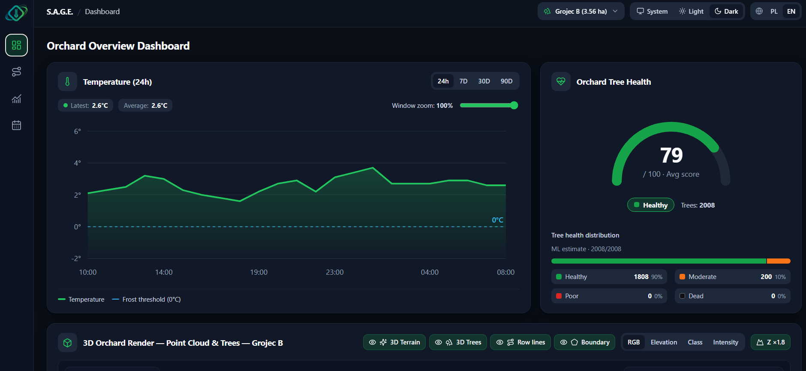
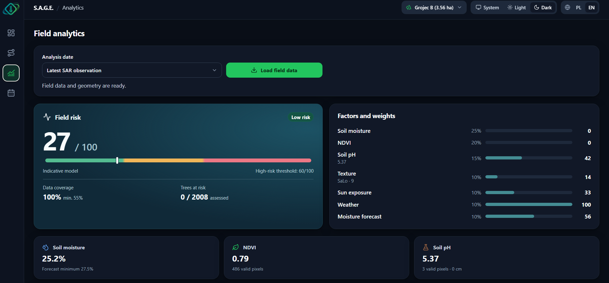

# [Wombat.exe] — Field Under Pressure

**Track:** Weather risk | Disease & pest | Yield & soil | Platform / dashboard
**Event:** [Field Under Pressure](https://geo-hackathon.g.location360.ag/) · 20–22 Nov 2026

## Team

| Name                  | Role               | Contact                 |
| --------------------- | ------------------ | ----------------------- |
| Nikita Szumak         | PM / Backend Dev   | szumaknikita@gmail.com  |
| Alicja Antosiak       | GIS Specialist     | aantosiak0111@gmail.com |
| Konrad Drewnowski     | Full-stack         | kontad.dr@gmail.com     |
| Krystian Fedorowicz   | Solution Architect | kungfupepus@gmail.com   |
| Krzysztof Mączyński | GIS Analyst        | kmacz.888@gmail.com     |

## One-liner

S.A.G.E. combines satellite imagery and weather forecasts to spot at-risk orchard trees and help growers decide where to irrigate now and where to wait.

## Problem & scope

- Focus area (crop, region, risk type): Apple and walnut orchards near Grójec, central Poland. The focus is soil that’s too dry or too wet and whether to irrigate or wait.
- In scope for the weekend: A working dashboard with satellite-derived soil moisture maps, a three-day weather-driven moisture forecast, and tree-level risk flags.
- Explicitly out of scope: Pest and disease diagnosis, spray or harvest recommendations, automated irrigation, and live integration with field sensors.

## Data we use

- [ ] Weather: Open-Meteo
- [ ] Satellite (Sentinel-1 SAR)
- [ ] Soil: Open Land Map
- [ ] Cropland: Apple and walnut orchards near Grójec, Poland. Orchard boundaries are stored as GeoJSON in our farm database
- [ ] Climate reanalysis: ERA5-Land
- [ ] LiDAR: Geoportal

- Notes / paths (local only — do not commit large files):

## How to run

# Getting started with S.A.G.E.

## 1. Get access to Earth Engine

Open the [`hackathon-515400` project](https://console.cloud.google.com/home/dashboard?project=hackathon-515400) with the Google account you plan to use. If you need access, select **Request permissions** and, when available, choose **Send auto-generated email → Send request**. Ask the project administrator to grant your account the **Earth Engine Resource Writer** and **Service Usage Consumer** roles. [Requesting access](https://docs.cloud.google.com/iam/docs/request-missing-permissions) · [Earth Engine roles](https://developers.google.com/earth-engine/guides/access_control)

You can also email your access request to `szumaknikita@gmail.com`.

Or you can create your own Google Cloud project and enable the Earth Engine API.

Before doing next step make sure you have GEE configured.

## 2. Clone the repository and run the setup script

You need Git, Python, and a running Docker installation with Docker Compose. On Windows, use **Git Bash**.

```bash
git clone --branch main https://github.com/KungFuPepus/field-under-pressure-materials.git
cd field-under-pressure-materials
bash setup.sh
```

The script sets up Python and Earth Engine, verifies your credentials, and starts the dashboard, API, and MongoDB. If a browser opens, choose an account with access to the project and grant access to Google Drive. To switch accounts, run `bash setup.sh --relogin`.

Open the address printed by the script. The default is the [S.A.G.E. dashboard](http://127.0.0.1:5173). Select an orchard and choose **Analytics → Load field data**.

The script selects the latest archive in `db/backups/`. A newer archive starts a fresh MongoDB volume. Rerunning with the same archive reuses its volume, and previous volumes retain their data.

## Demo notes (Sunday)

- What to show (1–2 screens / maps):



- Key result / insight: For a specific field in a 636-tree orchard near Grójec, S.A.G.E. flagged 15 trees for monitoring in its same-day risk forecast, giving growers a shortlist for field checks.
- Known limits / next steps: Integrating more precise sources of data

## Links

- Repo: [github.com/KungFuPepus/field-under-pressure-materials](https://github.com/KungFuPepus/field-under-pressure-materials)
- Slides / recording (if any): Demo video inside presentation.
